# Personal GTM Engine

An outbound engine built in n8n that finds B2B startups likely to need GTM automation, verifies who their founders are, writes a grounded first message for each, and puts every draft in a private review console. It runs on free tiers only and never sends anything by itself.

> **Demo:** [3-minute Loom walkthrough](LOOM_LINK_HERE)

## What it does

| Stage | Output |
|---|---|
| **Discover** | Companies from Y Combinator's public directory, Hacker News "Who is hiring" threads and a hand-picked seed list |
| **Filter** | Deterministic gates (domain, size, industry, keywords, timezone, seen-before) run before any paid or LLM call |
| **Score** | An explainable 0-100 account score with its breakdown and reasons |
| **Enrich** | Tech stack and hiring signals from the company's own website, then a metered Clay layer: a structured AI summary and a dated trigger (hiring, funding or news) per account |
| **Find people** | Founders read from the company's YC page (verified by website domain), Tavily search as a gated fallback, emails through Clay's Work Email waterfall |
| **Draft** | A LinkedIn note, a long message and three follow-ups, written by a Groq/Gemini fallback chain and checked by a rule-based validator |
| **Review** | A private Next.js console on Vercel, backed by Neon Postgres: approve, edit, reject or veto, then send by hand |
| **CRM** | Approved accounts land in HubSpot Free as a company, a contact and a deal (proven live, idempotent). Notes, tasks, the move to Contacted and the reply pull are built and pass 29 offline checks, pending the first real send. Details under Known limits. |

Clay layer: one structured AI call per account (1.0 credit, was 2.8), a signal set (jobs, news, funding) for about 0.9 credit, and the Work Email waterfall with Conservative validation at about 0.46 credit per verified email. n8n meters every batch through Clay's Public API.

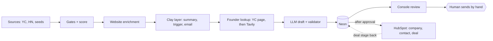

Full diagrams and the daily loop: [docs/ARCHITECTURE.md](docs/ARCHITECTURE.md)

## Results from the live runs

Numbers come from the engine's own telemetry in Neon (`ops`, `outreach_queue`, `console_events`, `sync_ops`, `hubspot_events`, `hubspot_links`), October 2026. The HubSpot rows also draw on the Sprint 13 test runs, with HubSpot read back through Claude's connector, and on `scripts/s13_sql_test.mjs`.

| Metric | Value |
|---|---|
| YC directory rows screened per run | 377, of which 23 pass the gates |
| Hacker News job posts screened per run | 495, of which 14 pass the gates |
| Accounts | 49, of which 43 qualified (score 65+, not rejected), each with a score breakdown |
| Contacts | 67, of which 37 have a verified email |
| Accounts with a Clay trigger / Clay summary | 19 / 39 |
| Live drafts | 42 (72 written, 30 superseded by a later regeneration), 7 approved |
| Engine runs logged | 44 |
| Review actions in the console | 17 |
| Sheets to Neon sync runs | 90 |
| Clay trial credits spent on data the engine reads | about 50, the rest left to expire on purpose |
| Messages sent without approval | 0 (the system never sends; the console allows **Mark sent** only on approved drafts) |
| Synced to HubSpot | 7 companies, 7 contacts, 7 deals |
| Second run writes | 0 (the Neon link table and outbox make a re-run a no-op) |
| Crash recovery | Deleted link adopted, not duplicated (0 duplicates, 7 of 7 companies) |
| Failure path | Bad config gives 7 readable HubSpot errors, run stays green, 0 quarantined |
| Offline SQL checks for the HubSpot layer | 29 of 29 |
| Monthly cost | $0 |

## Screenshots

**Review console**: the queue, one draft with its Clay trigger, and the run history.

| Queue | Draft | Runs |
|---|---|---|
| 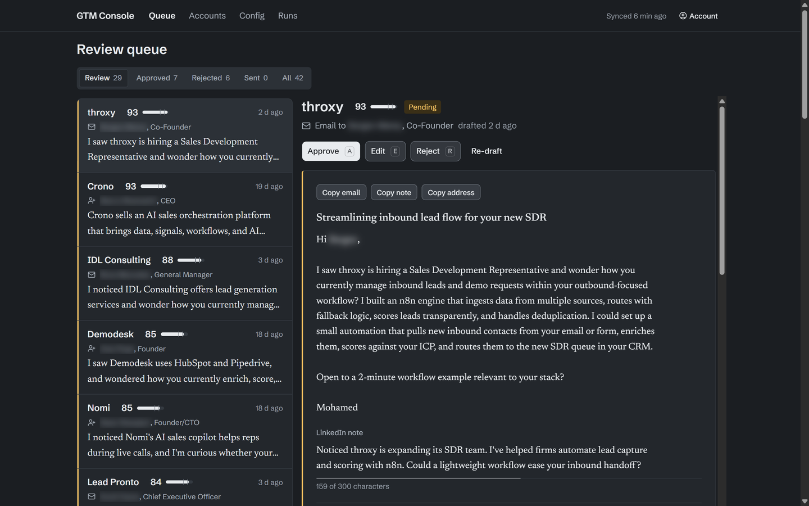 | 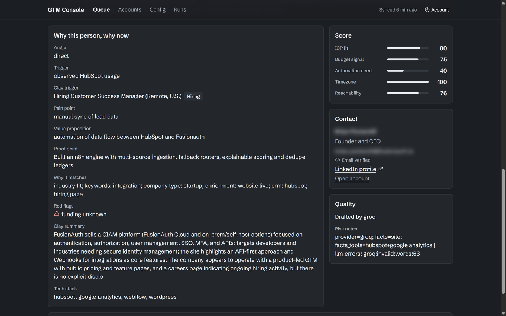 | 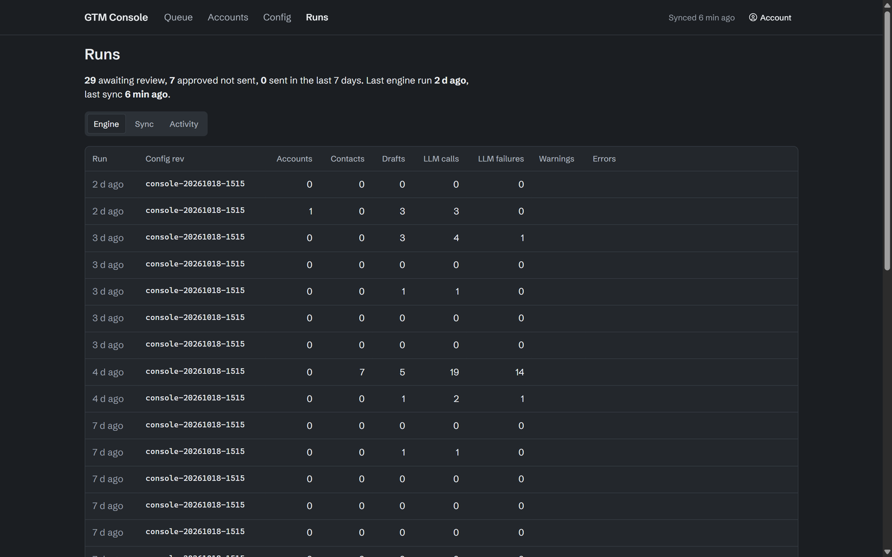 |

**HubSpot**: the deals board after the first sync, one deal per approved account.

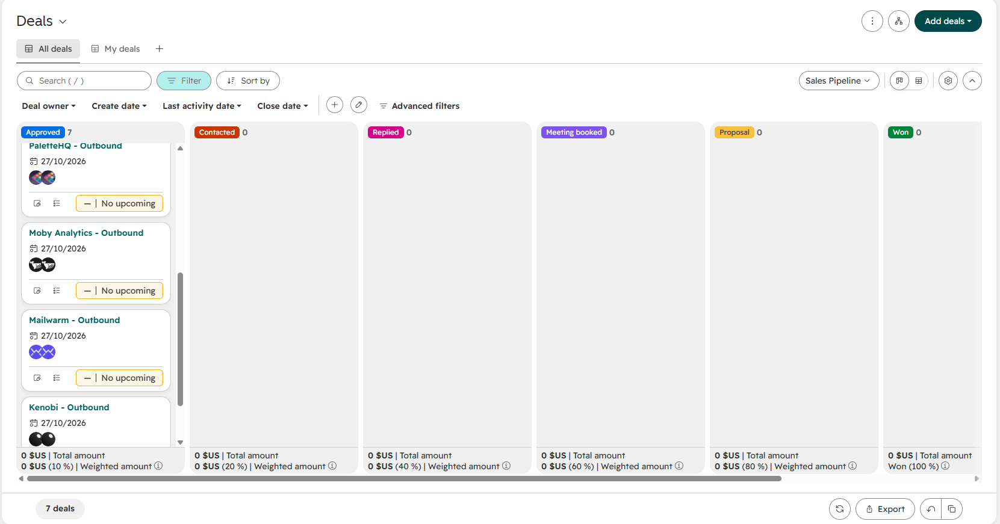

**CRM status in the console**: the draft page shows Company, Contact and Deal links plus the HubSpot stage.


**Workflows in n8n**, grouped in folders.

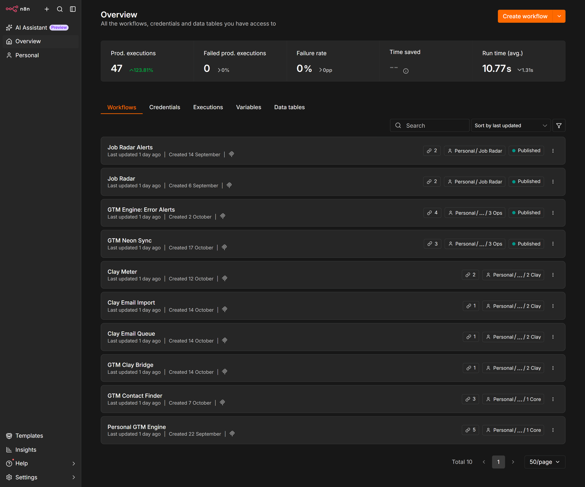

| Personal GTM Engine | GTM Contact Finder |
|---|---|
| 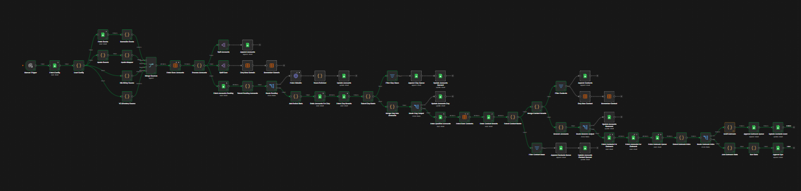 |  |

**Google Sheet**: accounts with score breakdowns, and the `ops` telemetry tab.

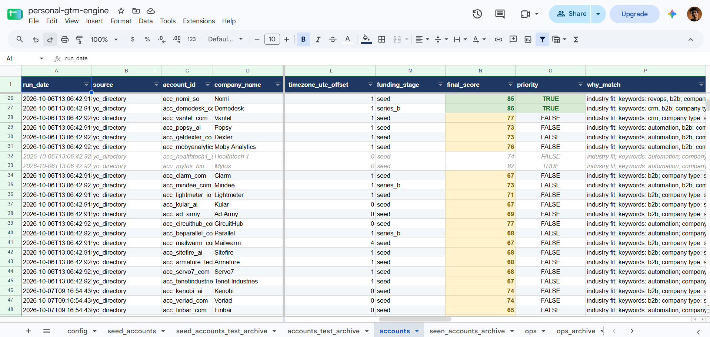

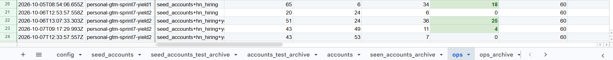

**Clay layer**: one structured research call per account, a run condition that skips low-score rows, and the email waterfall's cost history.

| Research column config | Accounts v2 table |
|---|---|
| 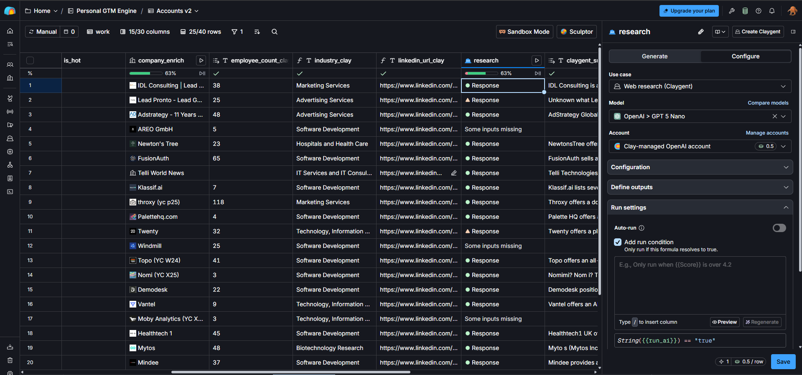 | 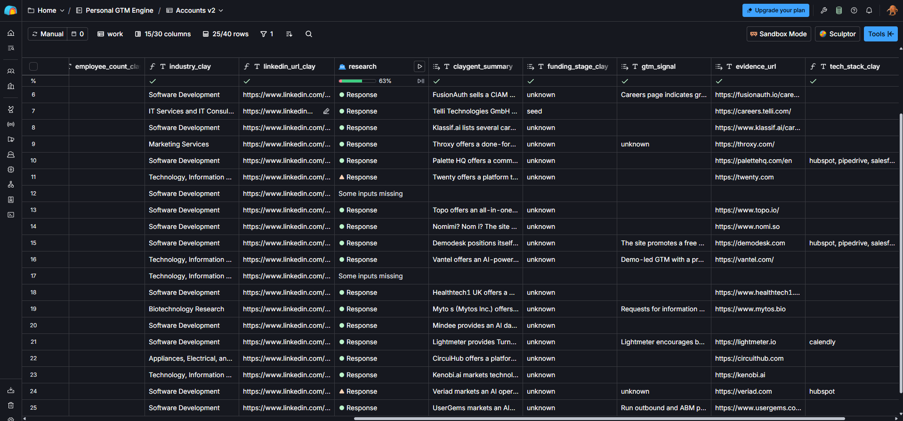 |

| Work Email waterfall config | Waterfall cost history |
|---|---|
| 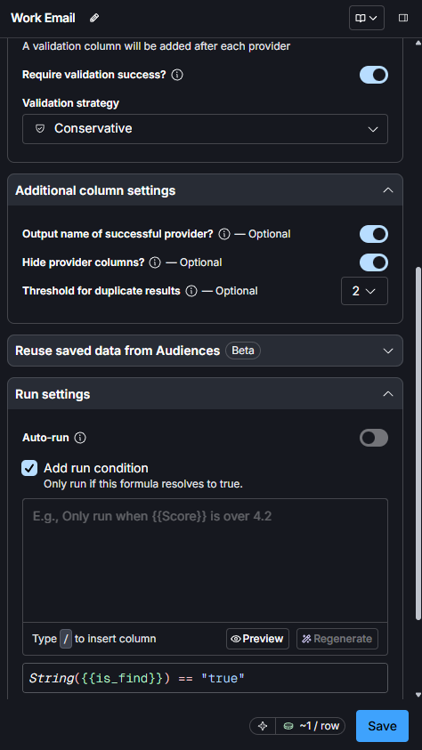 | 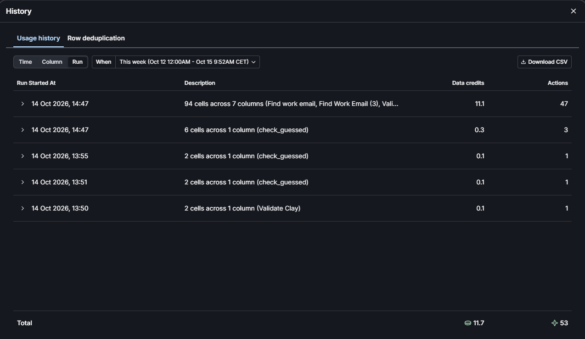 |

**Clay workflows in n8n**

| Clay Meter | GTM Clay Bridge | Clay Email Queue | Clay Email Import |
|---|---|---|---|
| 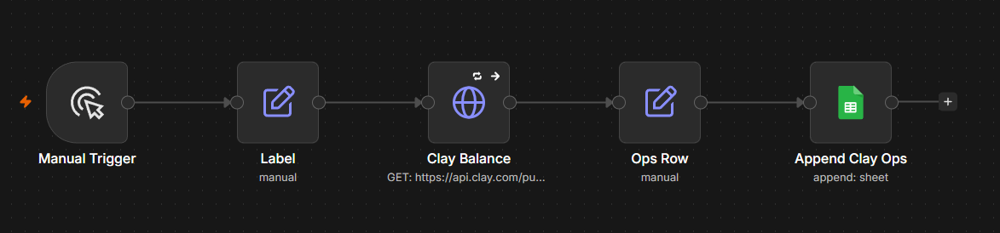 | 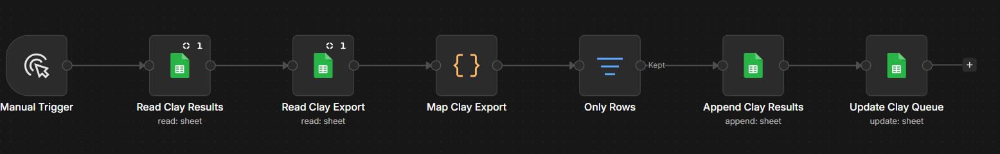 | 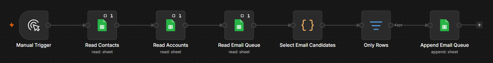 | 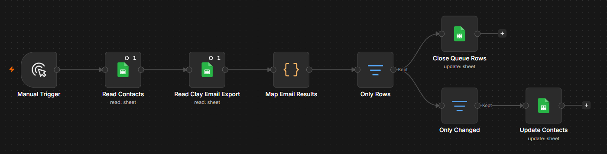 |

## Why it is built this way

| Principle | Where it shows |
|---|---|
| Deterministic gates before LLMs | Filters, scoring, tool detection, product-term guard and validation are plain code. The LLM only writes text from facts it is given. |
| Fallback chains | 3 Groq models, then Gemini, then a deterministic template. A draft row is always written. |
| Explainable scoring | Every account carries `score_breakdown`, `why_match` and `red_flags`. |
| Idempotent runs | Dedupe ledgers in n8n Data Tables, and drafts written to Neon through `gtm_insert_draft()`, mean a re-run never duplicates rows or messages. |
| Telemetry first | Every engine and sync run is logged and shown on the console's Runs page. Debugging starts there. |
| Human in the loop | The system drafts. A person approves in the console and sends by hand. The console writes only through `gtm_review`, `gtm_veto_account` and `gtm_save_config`. |
| Strangler migration | Neon is the system of record for drafts and config. Accounts and contacts still live in Sheets, mirrored into Neon every 15 minutes; their planned move targets Neon, while HubSpot holds only approved work. |
| Outbox, not scripts | Neon views compute exactly what HubSpot is missing, n8n carries it, Neon functions record every result. No Code nodes in the CRM sync. |
| Idempotent CRM sync | Neon link table first, natural-key search second, unique `gtm_account_key` on companies: a re-run writes nothing and a lost link is adopted, not duplicated (ADR-094). |
| Clear ownership | The engine owns the company and contact fields it sends; HubSpot owns the deal stage after creation (ADR-095). |

Decision log: [docs/ADR.md](docs/ADR.md) (87 architecture decision records). Original design: [docs/SPEC.md](docs/SPEC.md).

## CRM sync, how it stays correct

| Part | How |
|---|---|
| Neon outbox | Neon views list only what HubSpot is missing or what changed; n8n carries each row and Neon functions record the result. |
| Find-or-create | The `HubSpot Upsert Record` sub-workflow updates by id, else searches the natural key and adopts, else creates. The `hubspot_links` table and a unique `gtm_account_key` stop duplicates. |
| Guardrails | A row is quarantined after 3 failures, `hubspot.enabled` in config is a kill switch, and every contact carries a GDPR legal basis (ADR-102). |
| Claude on top | Claude's HubSpot connector is a read-mostly operator layer for pipeline reviews and audits, never the sync (ADR-098, ADR-101). |

## Stack

| Layer | Tool | Plan |
|---|---|---|
| Orchestration | n8n, self-hosted in Docker | Free |
| State | Neon Postgres (drafts, config, mirrors), Google Sheets via a service account, n8n Data Tables | Free |
| Review | Next.js console on Vercel, password gate | Free |
| CRM | HubSpot Free CRM, Service Key auth, date-versioned API `2026-09` | Free |
| Discovery | YC public directory, HN Algolia API, seed sheet | Free |
| Enrichment | Website fetch with regex signatures, Clay (structured AI research, signals, Work Email waterfall, Public API meter) | Free / free credits |
| People | YC company pages, Tavily Search | Free / free credits |
| LLM | Groq (`openai/gpt-oss-120b`, `qwen/qwen3.8-27b`, `openai/gpt-oss-20b`), Gemini | Free tiers |
| Alerts | Discord webhook, workflow failures only | Free |

## Repository layout

```text
workflows/                    sanitized n8n exports (import these)
  personal_gtm_engine.json    discovery, scoring, enrichment, contacts, drafting
  gtm_contact_finder.json     founder lookup: YC pages, then Tavily
  gtm_neon_sync.json          every 15 min: console decisions to Sheets, Sheets mirrored into Neon
  gtm_clay_bridge.json        imports the Clay accounts export: clay_results and account triggers
  clay_email_queue.json       picks one primary contact per account for Clay
  clay_email_import.json      applies Clay email results to contacts
  clay_meter.json             reads the Clay credit balance into clay_ops
  gtm_error_alerts.json       posts workflow failures to Discord
  gtm_hubspot_sync.json       every 30 min: Neon outbox to HubSpot, deal stages back
  hubspot_upsert_record.json  sub-workflow: update, adopt or create one HubSpot record
  retired/                    workflows replaced by the console (Discord digest)
gtm-console/                  Next.js review console (see gtm-console/README.md)
db/schema.sql                 Neon tables, views and functions (includes the HubSpot layer)
db/s13_*.sql                  Sprint 13 migrations for databases created before it
config/config.example.json    the full runtime config (seeded from the sheet, then edited in the console)
docs/ARCHITECTURE.md          diagrams, workflow map and the daily loop
docs/SHEET_SCHEMA.md          every tab, its writer and reader
docs/SETUP.md                 step-by-step install
docs/ADR.md                   architecture decisions
docs/SPEC.md                  original specification
scripts/sanitize_workflows.py strips IDs, emails and secrets from n8n exports
.env.example                  environment variables the workflows read
```

## Quick start

1. Create the Google Sheet with the tabs in [docs/SHEET_SCHEMA.md](docs/SHEET_SCHEMA.md) and paste `config/config.example.json` into `config!B2`. The first sync imports it into Neon; after that you edit it in the console.
2. Create a Neon project and run `db/schema.sql`.
3. Set the variables from `.env.example` in your n8n container.
4. Import the 8 core files in `workflows/`, then reconnect credentials (Google service account, Neon, Tavily, Clay, Discord), the sheet and the Data Tables. Publish `GTM Neon Sync`. The 2 HubSpot workflows are optional: [docs/SETUP.md](docs/SETUP.md) section 11.
5. Deploy `gtm-console/` to Vercel (see [gtm-console/README.md](gtm-console/README.md)).
6. Run: Engine, then Contact Finder, then Engine again, then review in the console.

Details and expected outputs: [docs/SETUP.md](docs/SETUP.md)

## Known limits

- The engine runs on demand; GTM Neon Sync (15 min) and GTM HubSpot Sync (30 min) run on schedules while n8n is on.
- Two stores: accounts and contacts live in Sheets, drafts and config in Neon, bridged by a 15-minute sync. Moving everything to one store targets Neon (ADR-090).
- HubSpot lags Neon by up to 30 minutes and syncs only while n8n runs on the laptop. Notes, tasks, the move to Contacted and the reply pull are built and pass the offline SQL test (29 checks) but are not yet proven live: they wait for the first real send (tests T8, T9). Replies are recorded by moving the deal stage by hand.
- Founder lookup is strongest for YC companies. Others rely on search with name, company and location gates, and a human check.
- The product-term guard catches companies that describe their product with repeated words. A product named once can slip through, which the review step catches.
- Free LinkedIn accounts allow only a handful of personalized connection notes per month, so the daily draft cap is deliberately low.

## History

Until Sprint 12, review happened through a Discord card per draft, sent by a scheduled digest workflow, with approval in the Sheet. The console replaced both. The old card and workflow are kept for reference: [Discord card](screenshots/discord-card.png), [digest workflow](screenshots/Persona-GTM-Digest-Canva.png), `workflows/retired/personal_gtm_digest.json`.

## License

MIT
