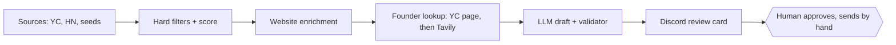

# Personal GTM Engine

An outbound engine built in n8n that finds B2B startups likely to need GTM automation, verifies who their founders are, writes a grounded first message for each, and sends every draft to Discord for human approval. It runs on free tiers only and never sends anything by itself.

> **Demo:** [3-minute Loom walkthrough](LOOM_LINK_HERE)

## What it does

| Stage | Output |
|---|---|
| **Discover** | Companies from Y Combinator's public directory, Hacker News "Who is hiring" threads and a hand-picked seed list |
| **Filter** | Deterministic gates (domain, size, industry, keywords, timezone, seen-before) run before any paid or LLM call |
| **Score** | An explainable 0-100 account score with its breakdown and reasons |
| **Enrich** | Tech stack and hiring signals from the company's own website, optional Clay summaries |
| **Find people** | Founders read from the company's YC page (verified by website domain), Tavily search as a gated fallback |
| **Draft** | A LinkedIn note, a long message and three follow-ups, written by a Groq/Gemini fallback chain and checked by a rule-based validator |
| **Review** | One Discord card per draft with everything needed to decide; approval happens in the sheet |



Full diagrams: [docs/ARCHITECTURE.md](docs/ARCHITECTURE.md)

## Results from the live runs

Numbers below come from the engine's own telemetry (`ops` and `digest_ops` tabs), October 2026.

| Metric | Value |
|---|---|
| YC directory rows screened per run | 377, of which 23 pass the gates |
| Hacker News job posts screened per run | 495, of which 14 pass the gates |
| Accounts in the sheet | 48, each with a score breakdown |
| Founders found from YC pages | 19 people at 10 companies, 0 search credits |
| Drafts in the last run | 8 of 8 accepted by the validator, 0 fell back to the template |
| LLM calls in the last run | 27, of which 19 were retries after a validator rejection or a rate-limit wait. No draft lost. |
| Messages sent without approval | 0 |
| Monthly cost | $0 |

## Why it is built this way

| Principle | Where it shows |
|---|---|
| Deterministic gates before LLMs | Filters, scoring, tool detection, product-term guard and validation are plain code. The LLM only writes text from facts it is given. |
| Fallback chains | 3 Groq models, then Gemini, then a deterministic template. A draft row is always written. |
| Explainable scoring | Every account carries `score_breakdown`, `why_match` and `red_flags`. |
| Idempotent runs | Ledgers in n8n Data Tables and the outreach queue mean a re-run never duplicates rows or messages. |
| Telemetry first | Every run appends counters and error samples to `ops`. Debugging starts there. |
| Human in the loop | The system drafts and alerts. A person approves and sends. |

Decision log: [docs/ADR.md](docs/ADR.md) (66 architecture decision records). Original design: [docs/SPEC.md](docs/SPEC.md).

## Stack

| Layer | Tool | Plan |
|---|---|---|
| Orchestration | n8n, self-hosted in Docker | Free |
| State and review | Google Sheets via a service account, n8n Data Tables | Free |
| Discovery | YC public directory, HN Algolia API, seed sheet | Free |
| Enrichment | Website fetch with regex signatures, Clay (optional) | Free / free credits |
| People | YC company pages, Tavily Search | Free / free credits |
| LLM | Groq (`openai/gpt-oss-120b`, `qwen/qwen3.8-27b`, `openai/gpt-oss-20b`), Gemini | Free tiers |
| Review | Discord webhook | Free |

## Repository layout

```text
workflows/                    sanitized n8n exports (import these)
  personal_gtm_engine.json    discovery, scoring, enrichment, contacts, drafting
  gtm_contact_finder.json     founder lookup: YC pages, then Tavily
  personal_gtm_digest.json    Discord review cards
config/config.example.json    the full runtime config (lives in the sheet's config tab)
docs/ARCHITECTURE.md          diagrams and stage details
docs/SHEET_SCHEMA.md          every tab, header row and status value
docs/SETUP.md                 step-by-step install
docs/ADR.md                   architecture decisions
docs/SPEC.md                  original specification
scripts/sanitize_workflows.py strips IDs, emails and secrets from n8n exports
.env.example                  environment variables the workflows read
```

## Quick start

1. Create the Google Sheet with the tabs in [docs/SHEET_SCHEMA.md](docs/SHEET_SCHEMA.md) and paste `config/config.example.json` into `config!B2`.
2. Set the variables from `.env.example` in your n8n container.
3. Import the three files in `workflows/`, then reconnect credentials, the sheet and the Data Tables.
4. Run: Engine, then Contact Finder, then Engine again, then Digest.

Details and expected outputs: [docs/SETUP.md](docs/SETUP.md)

## Known limits

- Runs on demand. Scheduling needs n8n to be running, which is not worth an always-on host at this volume.
- Founder lookup is strongest for YC companies. Others rely on search with name, company and location gates, and a human check.
- The product-term guard catches companies that describe their product with repeated words. A product named once can slip through, which the review step catches.
- Free LinkedIn accounts allow only a handful of personalized connection notes per month, so the daily draft cap is deliberately low.

## License

MIT
