# Personal GTM Engine

[](https://github.com/mohamedlandolsi/personal-gtm-engine/actions/workflows/ci.yml)

An outbound engine built in n8n that finds B2B startups, GTM agencies and paid gig posts likely to need GTM automation, verifies who to contact, writes a grounded first message for each, and puts every draft in a private review console. Three lead tracks (SMB, agency, gig) share one spine. A scheduled Claude agent is a second lead source: it writes only through one Postgres function, which recomputes its score, dedupes it against the engine and parks bad drafts. It runs on free tiers only and never sends anything by itself.

## What it does

| Stage | Output |
|---|---|
| **Discover** | Companies from Y Combinator's public directory, Hacker News "Who is hiring" threads, the Clay experts directory (agencies) and a hand-picked seed list |
| **Lead tracks** (Sprint 15) | One `lead_track` column instead of a second project (ADR-113): `smb_direct` (B2B startups), `agency_partner` (boutique GTM agencies with overflow client work) and `gig_post` (public posts asking for n8n, Clay or HubSpot help, read from the forum's own notification emails because its terms forbid automated reads, ADR-119) |
| **Filter** | Deterministic gates (domain, size, industry, keywords, timezone, seen-before) run before any paid or LLM call |
| **Score** | An explainable 0-100 account score with its breakdown and reasons |
| **Enrich** | Tech stack and hiring signals from the company's own website, then a metered Clay layer: a structured AI summary and a dated trigger (hiring, funding or news) per account |
| **Find people** | Founders read from the company's YC page (verified by website domain), Tavily search as a gated fallback, emails through Clay's Work Email waterfall |
| **Gate and pick the pitch** | Fixed rules before any LLM call: skip accounts you rejected or vetoed, weak buying roles and small teams with no trigger; reject companies that sell GTM tooling or hardware; then code picks 1 of 6 angles from the homepage and the trigger (Sprint 14) |
| **Sprint 16 gates** (built, first live run pending) | A cached Tavily trigger check, an `smb_direct` ICP gate (no growth stage, 40 staff at most, no round of 15M+), consent countries that get LinkedIn only, and a Clay account check that the contact still works there and the team has no in-house GTM people |
| **Draft** | A LinkedIn note, a long message and three follow-ups for that angle, written by a Groq/Gemini fallback chain and checked by a rule-based validator. A draft that still fails is parked in `needs_redraft`, outside Review |
| **Review** | A private Next.js console on Vercel, backed by Neon Postgres: approve, edit, reject with a scope (contact, pitch or account) or veto, then send by hand |
| **Agent source** (Sprint 17) | A scheduled Claude task (Mon/Wed/Fri) reads public sources, calls the read-only `gtm_agent_check()` before it spends any credit, and writes each lead through `gtm_ingest_agent_lead()`. Its drafts land in the same console queue with a "Claude" chip |
| **Pipeline lane** (Sprint 18, lane A) | B2B startups with a product and no outbound engine get a sample-list offer: 3 to 5 real accounts that fit the startup's buyer, each with a dated, sourced trigger. The database checks every row and renders the list |
| **Job routing** (Sprint 18, lane E) | Roles that fit the owner's profile are logged on a "Jobs to apply to" card, never pitched. Since 2026-11-22 a job is routed only after a seniority gate and an open-posting check (ADR-145) |
| **CRM** | Approved accounts land in HubSpot Free as a company, a contact and a deal (proven live, idempotent). After a send, the sync adds a note and a task and moves the deal to Contacted, live since the first sends (13 each). The reply pull is built but has no reply to record yet. |

Clay layer: one structured AI call per account (1.0 credit, was 2.8), a signal set (jobs, news, funding) for about 0.9 credit, and the Work Email waterfall with Conservative validation at about 0.46 credit per verified email. n8n meters every batch through Clay's Public API.

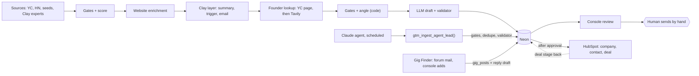

Full diagrams and the daily loop: [docs/ARCHITECTURE.md](docs/ARCHITECTURE.md)

## Results from the live runs

Numbers come from the engine's own telemetry in Neon (`ops`, `outreach_queue`, `console_events`, `sync_ops`, `hubspot_events`, `hubspot_links`, `agent_ingest_log`).

### November 22, 2026

Read from Neon production on 2026-11-22.

| Metric | Value |
|---|---|
| Accounts, each with a score and breakdown | 141: 126 from the engine (120 SMB, 6 agency), 15 from the Claude agent (13 SMB, 2 agency) |
| Agency accounts | 8, scored 70 to 83 (6 from the Clay experts directory, 2 from the agent) |
| Contacts with a verified email | 46 of 140 |
| Drafts | 109 written, 14 approved, 13 sent by hand |
| Engine drafts (generic pitch) | 94 written: 10 approved and sent, 54 rejected, 30 superseded, so 10 of 64 reviewed were approved |
| Claude lead digest runs | 3 runs, 18 calls: 15 inserted, 2 jobs routed, 1 rejected (product overlap), 0 errors |
| Claude agent drafts | 15: 4 approved (3 sent), 2 rejected, 9 pending |
| Sample-list drafts (lane A) | 6 written: 3 approved, 1 rejected, 2 pending |
| Lane A approval rate, first two weeks | To fill on 2026-12-03; so far 3 of the first 4 reviewed approved (n = 4), against 10 of 64 for the engine's generic pitch |
| Synced to HubSpot | 18 companies, 18 contacts, 18 deals; 13 notes, 13 tasks and 13 deals moved to Contacted by the sync |
| Deal stages pulled back from HubSpot | 13 Contacted, 4 Lost, 1 Approved |
| Engine runs / Sheets to Neon syncs / console review actions | 54 / 334 / 194 |
| Messages sent without approval | 0 (the system never sends; the console allows **Mark sent** only on approved drafts) |
| Monthly cost | $0 |

### October 2026

Run-level numbers from October. The HubSpot rows also draw on the Sprint 13 test runs, with HubSpot read back through Claude's connector, and on `scripts/s13_sql_test.mjs`.

| Metric | Value |
|---|---|
| YC directory rows screened per run | 377, of which 23 pass the gates |
| Hacker News job posts screened per run | 495, of which 14 pass the gates |
| Accounts with a Clay trigger / Clay summary | 19 / 39 |
| Clay trial credits spent on data the engine reads | about 50, the rest left to expire on purpose |
| Second HubSpot sync run writes | 0 (the Neon link table and outbox make a re-run a no-op) |
| Crash recovery | Deleted link adopted, not duplicated (0 duplicates, 7 of 7 companies) |
| Failure path | Bad config gives 7 readable HubSpot errors, run stays green, 0 quarantined |
| Offline SQL checks for the HubSpot layer | 29 of 29 |

### Sprint 14 acceptance runs (November 12 and 13, 2026)

Sprint 14 put fixed rules in front of the LLM after a review found that 4 of 7 "approved" drafts should not go out. The first runs with those rules:

| Metric | Value |
|---|---|
| Accounts skipped because you rejected or vetoed them | 12, exactly as the dry run predicted |
| Drafts written | 6 pending, plus 3 gate rows (1 GTM-tool seller, 2 with no fitting angle), 0 LLM calls on gated accounts |
| Template or invalid drafts that reached Review | 0 |
| Drafts to technical contacts, blocked accounts or teams under 10 without a trigger | 0 |
| Founders found, then verified by the Clay email waterfall | 9 of 9 |
| LLM failure rate | 0.63 on the first run. 8 of the 10 failures were two validator false positives, fixed in the Sprint 14 patch (commit `d0d8c7b`) |
| Messages sent | 8, each approved in the console and sent by hand |

## Sprints 15 to 18

What each sprint shipped, what is proven live and what is still open (Neon, 2026-11-22).

**Sprint 15: lead tracks**

| | |
|---|---|
| Shipped | `lead_track` on accounts and drafts; an agency lane in the engine fed by the Clay experts directory; `GTM Gig Finder` (Neon only, forum notification mail and console adds); track filters and a Gigs page in the console; `gtm_lead_track` on HubSpot companies and deals |
| Live | 6 agency accounts from the directory, scored 70 to 83 |
| Open | Gig Finder: 3 runs, 0 posts so far (mail lane only, ADR-119). No engine agency drafts yet (no `GTM Run` since 2026-11-16). The n8n experts directory is off after an HTTP 403 |

**Sprint 16: draft accuracy gates**

| | |
|---|---|
| Shipped | Neon: `trigger_checks`, `account_checks` and 3 draft columns (`contact_verified_at`, `contact_verified_title`, `gtm_people`), live on production. n8n: trigger check, `smb_direct` ICP gate, consent countries and Clay account check, applied to the engine on 2026-11-17 |
| Live | Built, not yet run: 0 rows in both tables; the last engine run was 2026-11-16 |
| Open | The first live run. Phases 4 to 6 (founder roles from YC bios, validator v4, the code-added footer) are not built |

**Sprint 17: the Claude agent as a lead source**

| | |
|---|---|
| Shipped | `gtm_ingest_agent_lead()` as the agent's only write path, the read-only `gtm_agent_check()`, `agent_ingest_log` and `v_agent_ingest_runs`; agent rows live in Neon only (ADR-134). Console: "Claude" chip, Source filter, digest card on the Runs page |
| Live | 3 runs, 0 errors. 16 database test cases on a Neon branch; the function's md5 is identical on the branch and production |
| Open | Agent and engine scores come from different rubrics, so the console marks the source instead of ranking them together (ADR-135) |

**Sprint 18: pipeline lane and job routing**

| | |
|---|---|
| Shipped | Lane A sample-list offer with its gates in the database (ADR-137, ADR-138), the engine's product-overlap gate on agent leads (ADR-139), attribution and fresh-funding validators (ADR-142), optional buyer names in sample rows (ADR-144), lane E job routing (ADR-141) with the seniority and open-posting gates in prompt v4 (ADR-145, first v4 run 2026-11-23). Console: Sample list panel and chip, "Jobs to apply to" card |
| Live | 6 sample-list drafts, 3 of the first 4 reviewed approved (n = 4). Sample rows opened by hand against their source pages: 6 of 6 correct in the hand test; on the first run 9 of 9 opened, 2 moved from an aggregator to the original article, 1 date corrected. The first lane A rubric passed 0 of 3 hand-test startups (scores 44, 51, 48); after ADR-143, 2 of 3 were inserted (73, 58). 13 database test cases on a Neon branch. 2 jobs routed, both later found closed, which led to ADR-145 |
| Open | The two-week lane A approval number, to fill on 2026-12-03 |

## Screenshots

**Review console**: the queue, one draft with its Clay trigger, and the run history.

| Queue | Draft | Runs |
|---|---|---|
| 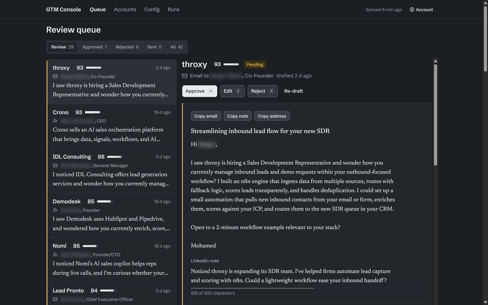 | 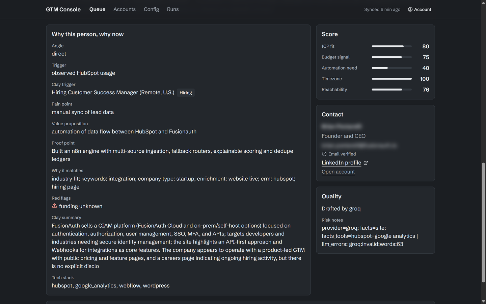 | 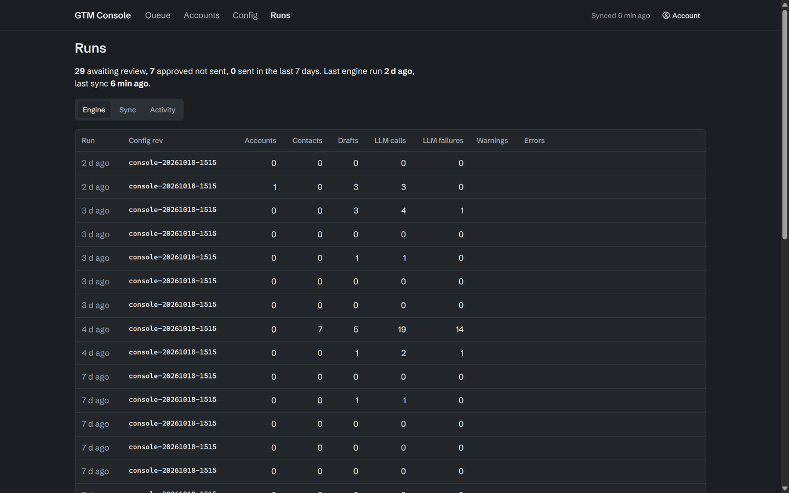 |

**HubSpot**: the deals board after the first sync, one deal per approved account.

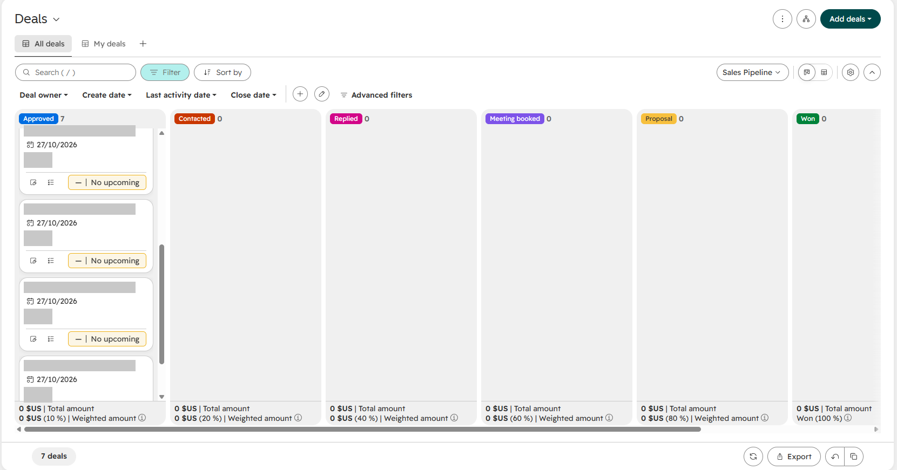

**CRM status in the console**: the draft page shows Company, Contact and Deal links plus the HubSpot stage.


**Workflows in n8n**, grouped in folders.

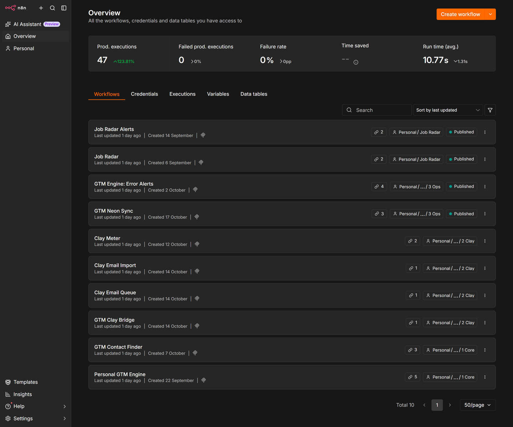

| Personal GTM Engine | GTM Contact Finder |
|---|---|
| 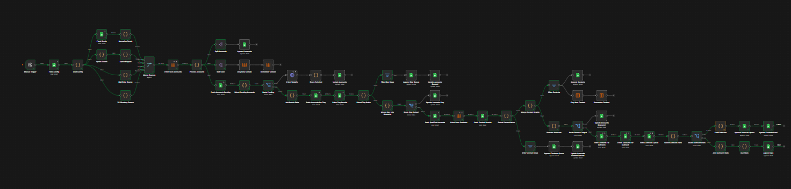 |  |

**Google Sheet**: accounts with score breakdowns, and the `ops` telemetry tab.

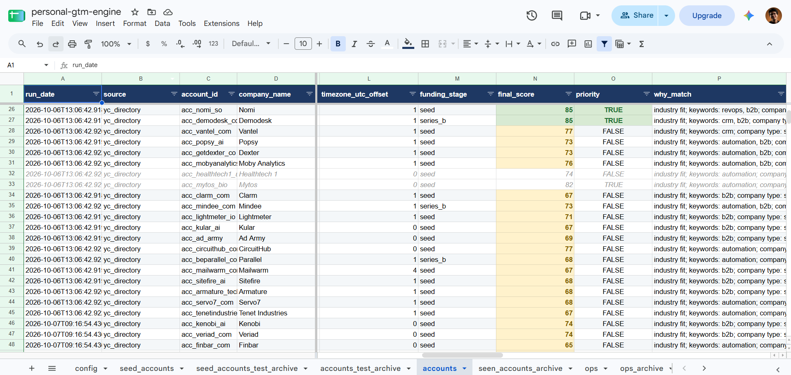

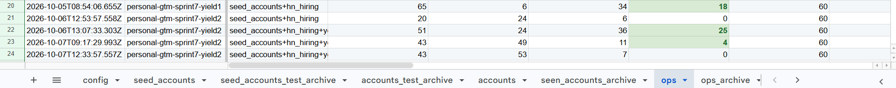

**Clay layer**: one structured research call per account, a run condition that skips low-score rows, and the email waterfall's cost history.

| Research column config | Accounts v2 table |
|---|---|
| 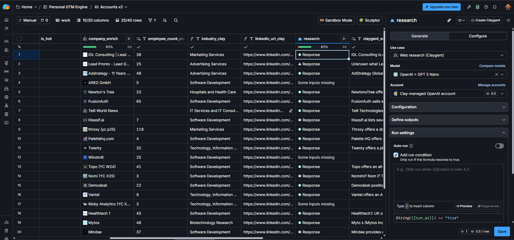 | 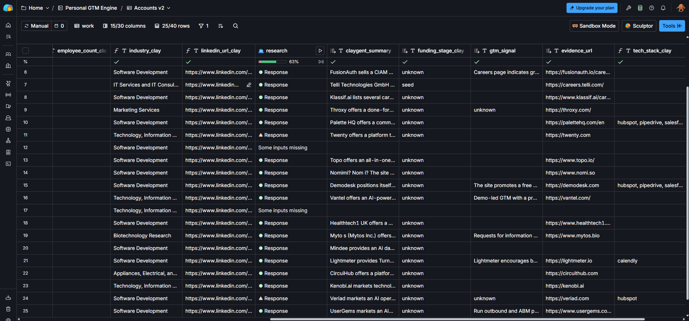 |

| Work Email waterfall config | Waterfall cost history |
|---|---|
| 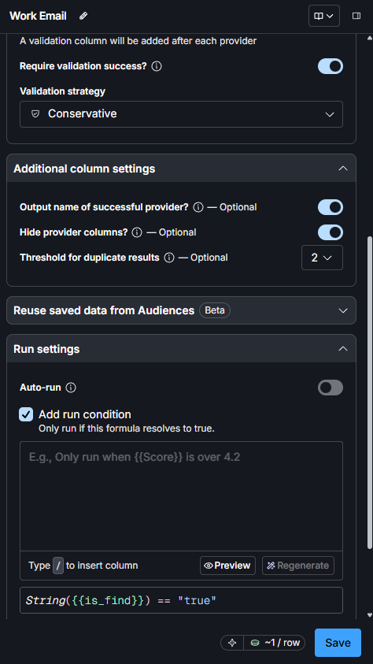 | 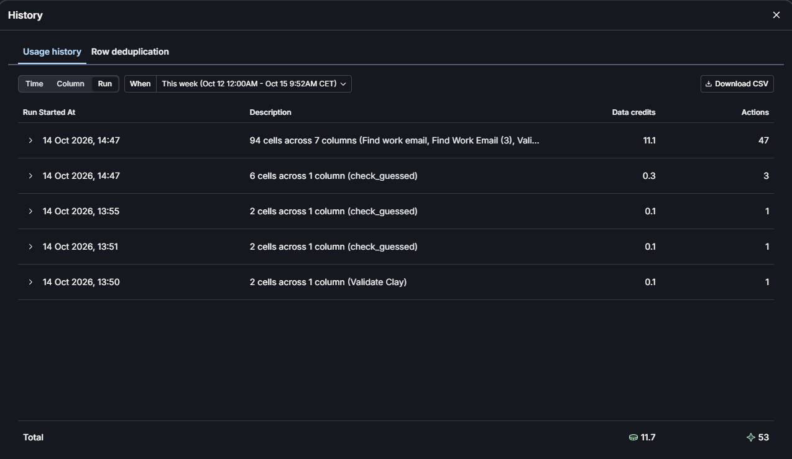 |

**Clay workflows in n8n**

| Clay Meter | GTM Clay Bridge | Clay Email Queue | Clay Email Import |
|---|---|---|---|
| 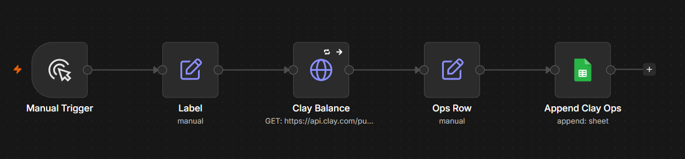 | 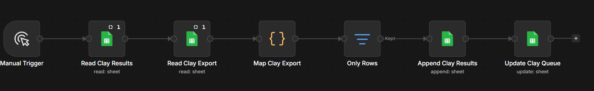 | 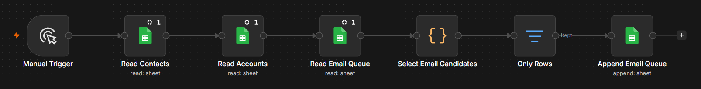 | 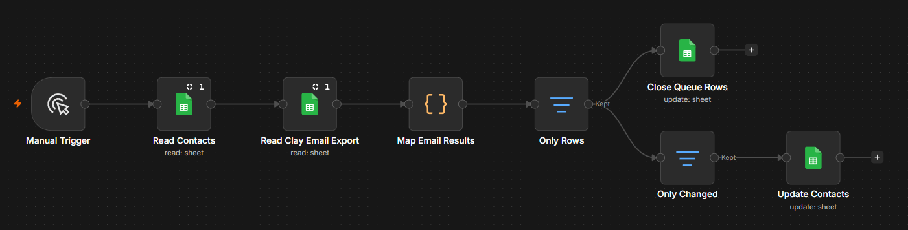 |

## Why it is built this way

| Principle | Where it shows |
|---|---|
| Deterministic gates before LLMs | Filters, scoring, tool detection, product-term guard and validation are plain code. The LLM only writes text from facts it is given. |
| Fallback chains | 3 Groq models, then Gemini, then a deterministic template. A draft row is always written. |
| Explainable scoring | Every account carries `score_breakdown`, `why_match` and `red_flags`. |
| Code picks the pitch | A fixed angle library (hiring bridge, lead delivery, client reporting, demo brief, booking follow-up, signup activation) chosen from evidence on the homepage or a dated trigger. The LLM only writes it (ADR-107). |
| Rejections teach the engine | A reject carries a scope. The Neon view `v_outreach_blocks` turns account and pitch rejections into skips on the next run, so the same company is not pitched twice (ADR-103). |
| Idempotent runs | Dedupe ledgers in n8n Data Tables, and drafts written to Neon through `gtm_insert_draft()`, mean a re-run never duplicates rows or messages. |
| Telemetry first | Every engine and sync run is logged and shown on the console's Runs page. Debugging starts there. |
| Human in the loop | The system drafts. A person approves in the console and sends by hand. The console writes only through `gtm_review`, `gtm_veto_account` and `gtm_save_config`. |
| Strangler migration | Neon is the system of record for drafts and config. Accounts and contacts still live in Sheets, mirrored into Neon every 15 minutes; their planned move targets Neon, while HubSpot holds only approved work. |
| Outbox, not scripts | Neon views compute exactly what HubSpot is missing, n8n carries it, Neon functions record every result. No Code nodes in the CRM sync. |
| Idempotent CRM sync | Neon link table first, natural-key search second, unique `gtm_account_key` on companies: a re-run writes nothing and a lost link is adopted, not duplicated (ADR-094). |
| Clear ownership | The engine owns the company and contact fields it sends; HubSpot owns the deal stage after creation (ADR-095). |
| Lead tracks, not a second project | One `lead_track` column on accounts and drafts reuses the dedupe, gates, LLM chain, console and HubSpot sync for SMBs, agencies and gig posts (ADR-113). |
| One write path for the agent | The Claude agent may run two statements only: the read-only `gtm_agent_check()` and `gtm_ingest_agent_lead()`. The function recomputes the score from five capped parts, enforces the gates, dedupes on domain, LinkedIn and email, and parks style problems as `needs_redraft`; every call is logged (ADR-133, ADR-135). |
| Proof, not a pitch | Lane A offers 3 to 5 real accounts that fit the prospect's buyer, each with a dated trigger and a source link. The database drops bad rows, rejects a list under 3, and renders it; no emails, phones or LinkedIn links of people at sample companies (ADR-137, ADR-140, ADR-144). |
| Jobs routed, not pitched | A role the owner could take is logged for applying, never drafted, and only after a seniority gate and an open-posting check (ADR-141, ADR-145). |

Decision log: [docs/ADR.md](docs/ADR.md) (130 architecture decision records). Original design: [docs/SPEC.md](docs/SPEC.md).

## CRM sync, how it stays correct

| Part | How |
|---|---|
| Neon outbox | Neon views list only what HubSpot is missing or what changed; n8n carries each row and Neon functions record the result. |
| Find-or-create | The `HubSpot Upsert Record` sub-workflow updates by id, else searches the natural key and adopts, else creates. The `hubspot_links` table and a unique `gtm_account_key` stop duplicates. |
| Guardrails | A row is quarantined after 3 failures, `hubspot.enabled` in config is a kill switch, and every contact carries a GDPR legal basis (ADR-102). |
| Claude on top | Claude's HubSpot connector is a read-mostly operator layer for pipeline reviews and audits, never the sync (ADR-098, ADR-101). |

## Stack

| Layer | Tool | Plan |
|---|---|---|
| Orchestration | n8n, self-hosted in Docker | Free |
| State | Neon Postgres (drafts, config, mirrors), Google Sheets via a service account, n8n Data Tables | Free |
| Review | Next.js console on Vercel, password gate | Free |
| CRM | HubSpot Free CRM, Service Key auth, date-versioned API `2026-09` | Free |
| Discovery | YC public directory, HN Algolia API, Clay experts directory, seed sheet; gig posts from forum notification mail (Gmail) | Free |
| Enrichment | Website fetch with regex signatures, Clay (structured AI research, signals, Work Email waterfall, Public API meter) | Free / free credits |
| People | YC company pages, Tavily Search | Free / free credits |
| LLM | Groq (`openai/gpt-oss-120b`, `qwen/qwen3.8-27b`, `openai/gpt-oss-20b`), Gemini | Free tiers |
| Agent | Claude scheduled task ("GTM lead digest", Opus, Mon/Wed/Fri) with the Neon connector, held to two SQL statements | Existing Claude plan |
| Agent sources | HN Algolia API, yc-oss API, funding news through web search and Tavily (at most 20 Tavily calls per run), Clay search (free) | Free / free credits |
| Agent enrichment | Apollo (at most 4 reveals per run, leads scoring 70+), Clay email (at most 1 per run, leads scoring 80+), JobsPipe (at most 1 search of up to 25 results, only above 100 credits); sample accounts are never enriched | Free credits |
| Alerts | Discord webhook: workflow failures and hot gig drafts | Free |

## Repository layout

```text
.github/workflows/ci.yml      console types and lint, node bodies, SQL tests, secret and email scan
workflows/                    sanitized n8n exports (import these; see Known limits)
  personal_gtm_engine.json    discovery, scoring, enrichment, contacts, drafting
  gtm_contact_finder.json     founder lookup: YC pages, then Tavily
  gtm_run.json                run chain: Gig Finder, Neon Sync, Engine, Contact Finder, Engine, Neon Sync
  gtm_gig_finder.json         gig lane (Sprint 15): forum mail and console adds into gig_posts and reply drafts
  gtm_neon_sync.json          every 15 min: console decisions to Sheets, Sheets mirrored into Neon
  gtm_clay_bridge.json        imports the Clay accounts export: clay_results and account triggers
  clay_email_queue.json       picks one primary contact per account for Clay
  clay_email_import.json      applies Clay email results to contacts
  clay_meter.json             reads the Clay credit balance into clay_ops
  gtm_error_alerts.json       posts workflow failures to Discord
  gtm_hubspot_sync.json       every 30 min: Neon outbox to HubSpot, deal stages back
  hubspot_upsert_record.json  sub-workflow: update, adopt or create one HubSpot record
  retired/                    workflows replaced by the console (Discord digest)
gtm-console/                  Next.js review console (see gtm-console/README.md)
db/schema.sql                 Neon tables, views and functions (HubSpot layer and Sprints 14 to 18 included)
db/s13_*.sql, db/s14_*.sql    migrations for databases created before Sprint 13 / 14
db/s15_*.sql                  Sprint 15: lead tracks and gig lane, HubSpot lead track
db/s16_trigger_checks.sql     Sprint 16: trigger and account checks
db/s17_agent_ingest.sql       Sprint 17: the Claude agent's write path and ingest log
db/s18_pipeline_lane.sql      Sprint 18: pipeline lane, sample list, job routing
config/config.example.json    the full runtime config (seeded from the sheet, then edited in the console)
docs/ARCHITECTURE.md          diagrams, workflow map and the daily loop
docs/SHEET_SCHEMA.md          every tab, its writer and reader
docs/SETUP.md                 step-by-step install
docs/ADR.md                   architecture decisions
docs/SPEC.md                  original specification
scripts/s14/                  Sprint 14 Code node bodies, as live in n8n, plus build and check scripts
scripts/s15/                  Sprint 15 source spike, spec, engine and gig Code node bodies with their tests
scripts/s13_sql_test.mjs      offline SQL tests (PGlite), also s14, s15 and s16_sql_test.mjs
scripts/check_*.mjs           CI checks: node bodies compile, no secrets or real emails
scripts/sanitize_workflows.py strips IDs, emails and secrets from n8n exports
.env.example                  environment variables the workflows read
```

## Quick start

1. Create the Google Sheet with the tabs in [docs/SHEET_SCHEMA.md](docs/SHEET_SCHEMA.md) and paste `config/config.example.json` into `config!B2`. The first sync imports it into Neon; after that you edit it in the console.
2. Create a Neon project and run `db/schema.sql`.
3. Set the variables from `.env.example` in your n8n container.
4. Import the 10 core files in `workflows/`, then reconnect credentials (Google service account, Neon, Tavily, Clay, Discord, and Gmail for the gig lane), the sheet and the Data Tables. Publish `GTM Neon Sync`. The 2 HubSpot workflows are optional: [docs/SETUP.md](docs/SETUP.md) section 11.
5. Deploy `gtm-console/` to Vercel (see [gtm-console/README.md](gtm-console/README.md)).
6. Run one batch (ADR-112): `GTM Run`, then the Clay email step (`Clay Email Queue`, the waterfall in Clay, `Clay Email Import`), then `GTM Run` again, then review in the console.
7. Optional: the Claude lead digest, a scheduled Claude task with the Neon connector that calls only `gtm_agent_check()` and `gtm_ingest_agent_lead()` ([docs/SPEC.md](docs/SPEC.md) section 48).

Details and expected outputs: [docs/SETUP.md](docs/SETUP.md)

## Known limits

- The files in `workflows/` are the Sprint 15 phase 4 exports. The live engine is ahead: the Sprint 16 nodes (trigger check, ICP gate, consent countries, Clay account check) were applied on 2026-11-17 and are not in the exports until the next export (`docs/SETUP.md` section 10).
- Sprint 16 is unrun: its tables are live and its nodes applied, but no engine run has used them yet (0 trigger checks, 0 account checks).
- The gig lane has found 0 posts so far (3 Gig Finder runs). It reads only the forum's notification mail, since the forum terms forbid automated reads (ADR-119).
- The agent is held to "two statements only" by its prompt, not by a database role: the Neon connector has owner rights. `gtm_ingest_agent_lead()` and `agent_ingest_log` make any deviation visible (ADR-133).
- Agent and engine scores use different rubrics, so they are not directly comparable (ADR-135).
- Lane A numbers are early: 3 of the first 4 reviewed sample-list drafts were approved (n = 4). The two-week number lands on 2026-12-03.
- The Clay email step is manual between two `GTM Run`s, because the Clay Free plan has no API run for a table (ADR-112). Contacts without a verified email wait 3 days for it before they can get a LinkedIn draft.
- Angle variety is still low: in the first Sprint 14 run, 5 of 6 drafts used the demo-brief angle, the trade-off ADR-107 accepted for grounded pitches.
- The engine runs on demand; GTM Neon Sync (15 min) and GTM HubSpot Sync (30 min) run on schedules while n8n is on.
- Two stores: accounts and contacts live in Sheets, drafts and config in Neon, bridged by a 15-minute sync. Moving everything to one store targets Neon (ADR-090).
- HubSpot lags Neon by up to 30 minutes and syncs only while n8n runs on the laptop. The reply pull is built and passes the offline SQL test but is not yet proven live: no reply has been recorded so far. Replies are recorded by moving the deal stage by hand.
- Founder lookup is strongest for YC companies. Others rely on search with name, company and location gates, and a human check.
- The product-term guard catches companies that describe their product with repeated words. A product named once can slip through, which the review step catches.
- Free LinkedIn accounts allow only a handful of personalized connection notes per month, so the daily draft cap is deliberately low.

## History

Until Sprint 12, review happened through a Discord card per draft, sent by a scheduled digest workflow, with approval in the Sheet. The console replaced both. The old card and workflow are kept for reference: [Discord card](screenshots/discord-card.png), [digest workflow](screenshots/Persona-GTM-Digest-Canva.png), `workflows/retired/personal_gtm_digest.json`.

## License

MIT
