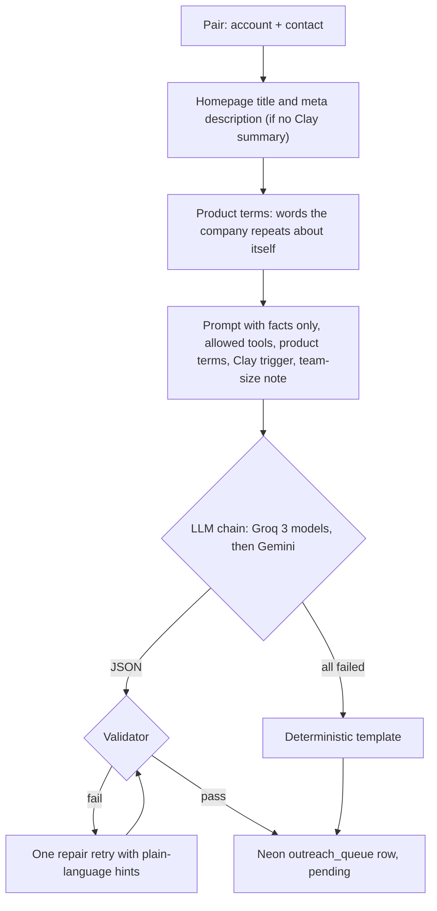

# Architecture

Ten n8n workflows, one Google Sheet, one Neon Postgres database, a Next.js review console and a HubSpot Free CRM. The engine and its helpers read and write the Sheet. Drafts and config live in Neon, which the console reads and writes. `GTM Neon Sync` bridges the two every 15 minutes. After you approve a draft, `GTM HubSpot Sync` puts the account in HubSpot and copies deal stages back. Every hand-off between workflows is a tab or a table you can inspect and correct.

```
                 Inputs                       n8n (Docker on your laptop)                     Stores
  seed_accounts, YC, HN  ---> Personal GTM Engine (manual) ---------------------> Sheets: accounts, contacts, queues, ops
                                   |   ^                                                   |
                                   |   +--- GTM Contact Finder (manual, Tavily gate) <-----+ contacts_queue / contact_results
                                   |
                                   +--> drafts: gtm_insert_draft() ---------------> Neon: outreach_queue (system of record)
                                   +--> config: n8n_config_sheet <----------------- Neon: config_versions (console owns)

  Sheets <-- GTM Neon Sync (every 15 min): pushes console vetoes, re-drafts and config, mirrors accounts, contacts, ops, config into Neon
  Neon   <-- GTM Console (Next.js on Vercel, password gate): review, approve, edit, veto, config
  Neon  <--> GTM HubSpot Sync (every 30 min): approved accounts to HubSpot, deal stages back (see HubSpot layer)

  Clay workbook "Personal GTM Engine"
    clay_queue ---------> [Accounts v2] --CSV--> clay_export_accounts --> GTM Clay Bridge --> clay_results + accounts.clay_trigger*
    clay_contacts_queue -> [Contacts Email] --CSV--> clay_export_contacts --> Clay Email Import --> contacts
    Clay Email Queue builds clay_contacts_queue. Clay Meter logs credits to clay_ops.

  Failures --> GTM Engine: Error Alerts --> Discord
```

## Workflows

| Workflow | Nodes | Trigger | Job |
|---|---|---|---|
| Personal GTM Engine | 59 | Manual | Discovery, gates, scoring, website enrichment, contact merge, drafting into Neon |
| GTM Contact Finder | 13 | Manual | Founder lookup: YC page first, Tavily as a gated fallback |
| GTM Neon Sync | 15 | Every 15 min (published) | Pushes console decisions to Sheets, then mirrors Sheets into Neon through `gtm_sync_pull()` |
| GTM Clay Bridge | 11 | Manual | Imports the Clay accounts export into `clay_results` (new domains) and `accounts.clay_trigger*` (all domains) |
| Clay Email Queue | 7 | Manual | Picks one primary contact per account for the Clay email waterfall |
| Clay Email Import | 8 | Manual | Applies Clay email results to `contacts`; never downgrades a verified email |
| Clay Meter | 5 | Manual | Reads the Clay credit balance into `clay_ops`, before and after each Clay run |
| GTM Engine: Error Alerts | 2 | Error trigger | Error workflow of the Engine and both syncs; posts failures to Discord |
| GTM HubSpot Sync | 24 | Every 30 min (published) | Reads the Neon outbox in 6 steps (companies, contacts, deals, notes, tasks, stage moves), pushes each row through `HubSpot Upsert Record`, records results with `gtm_hubspot_record()`, then pulls changed deal stages back with `gtm_hubspot_pull_stages()` |
| HubSpot Upsert Record | 11 | Called by GTM HubSpot Sync (published sub-workflow) | One record: update by HubSpot id, or search the natural key and adopt, or create with associations. Returns ok, action, id or error |

In n8n they sit in folders: `1 Core` (Engine, Contact Finder), `2 Clay` (Bridge, Email Queue, Email Import, Meter), `3 Ops` (Neon Sync, Error Alerts), `4 CRM` (HubSpot Sync, HubSpot Upsert Record).

Each workflow sits on a real boundary: a human step (Contact Finder results, Clay runs, CSV exports), a paid-credit gate (Tavily, Clay), or an external tool.

## HubSpot layer

Neon decides what goes to HubSpot and remembers what is already there; n8n only carries the requests. Only human-approved (or sent) drafts of accounts that are not vetoed are in scope. After a deal exists, HubSpot owns its stage and the sync copies it back. Schema: the Sprint 13 block of `db/schema.sql` (also kept as `db/s13_hubspot.sql`).

```
                         Neon (decides and remembers)                                   HubSpot Free
  outreach_queue --+                                                                   (CRM for approved work)
  accounts --------+--> v_hubspot_scope --> v_hubspot_outbox (steps 1..6, API JSON)
  contacts --------+          approved or sent,        |   ^
  config_versions -+          account not vetoed       |   |  only rows whose parents are linked,
     .hubspot                                          |   |  only changed rows, max_per_run, quarantine
                                                       v   |
  n8n (laptop)   GTM HubSpot Sync (every 30 min + manual)  |
                   Read HubSpot Config --> HubSpot Enabled? |
                     |-- 1 Companies  -->  Push --> HubSpot Upsert Record (sub-workflow) --+--> companies
                     |-- 2 Contacts   -->  Push --> (update by id | search key + adopt |   +--> contacts
                     |-- 3 Deals      -->  Push -->  create with associations)         +--> deals (stage Approved)
                     |-- 4 Notes      -->  Push -->                                    +--> notes   (on send)
                     |-- 5 Tasks      -->  Push -->                                    +--> tasks   (on send)
                     |-- 6 Stage move -->  Push -->                                    +--> deal stage Contacted
                     |        each Push --> Save --> gtm_hubspot_record() --> hubspot_links + hubspot_events
                     +-- 7 Search Changed Deals (since watermark) <------------------------ deal stages you move
                              --> Save Deal Stages --> gtm_hubspot_pull_stages()
                                    --> hubspot_links.deal_stage, outreach_queue.reply_received, console_events

  Console (Vercel) reads v_crm_status, v_hubspot_runs: CRM links, deal stage, HubSpot tab on Runs
  Failures --> GTM Engine: Error Alerts --> Discord (unchanged)
```

A re-run writes nothing: `hubspot_links` remembers every HubSpot id, and the outbox lists only rows that are new or changed. A row that fails 3 times since its last success is quarantined (`v_hubspot_quarantine`) instead of retried every run.

## Daily loop

1. Start Docker. `GTM Neon Sync` runs every 15 minutes and `GTM HubSpot Sync` every 30 minutes on their own.
2. Run `GTM Contact Finder` when new accounts are queued.
3. Run `Personal GTM Engine`.
4. Open the console (phone is fine): review, edit, approve, send by hand, **Mark sent**.
5. Clay, only when needed. Emails: `Clay Email Queue` > run the waterfall in Clay by selection > export > import CSV > `Clay Email Import`. Accounts: run in Clay by selection > export > import CSV > `GTM Clay Bridge`. Run `Clay Meter` before and after.

Every stage is idempotent: the Data Table ledgers (`seen_accounts`, `seen_contacts`), `contact_results`, `clay_results` and the Neon `outreach_queue` make a re-run write nothing new.

## Stage details

### Discovery and gates

| Source | How | Free tier use |
|---|---|---|
| `seed_accounts` tab | Read every run | None |
| Hacker News "Who is hiring" | Algolia API, two latest threads, strong-keyword gate | None (public API) |
| YC company directory | Public directory by tag, active companies with a website | None (public data) |
| Apollo company search | Code node, off by default (free plan returns nothing useful) | Credits only if enabled |

Hard filters run before any enrichment or LLM call: domain required, employee range, industry include/exclude, keyword include/exclude, UTC offset, company type, seen-before. Each rejection reason is counted in `ops.rejection_summary`.

### Enrichment

One GET per new account. Regex signatures detect CRM and tooling (HubSpot, Salesforce, Pipedrive, Stripe, Intercom and more) and hiring pages. Clay is a human-bridged step: n8n queues high scorers in `clay_queue`, you run `Accounts v2` in Clay by selection, export the CSV, and `GTM Clay Bridge` merges the summary and the trigger as evidence. Both Clay tables have auto-run off, so nothing spends credits by itself.

### Contact finder

1. For each queued account, guess the YC page slug and read the founders from the page's embedded JSON. Accepted only when the page lists the same website domain.
2. Accounts not on YC go to Tavily search restricted to LinkedIn profiles. Gates: the company name must be in the profile title or a current role, the location must not contradict the account's country. Name-only matches are kept as `tavily_unverified` and flagged on the draft.
3. Emails come later from Clay: `Clay Email Queue` picks one primary contact per account scoring 72+, plus every guessed email for validation.

### Drafting



Validator rules (deterministic): word counts per field, LinkedIn note length, follow-up lengths, company named in the first line, no links or placeholders, no money or percentages, no invented numbers, tool whitelist (only tools detected on the company's site), no first-person claims about the recipient, no partnership pitch, hedged statements only, no "which means" conclusions, no "ops team" at companies of 20 or fewer, and no product terms outside the observation. Every rejection reason lands in `risk_notes` so a reviewer sees why a draft needed a retry.

### Human in the loop

Nothing is sent by the system. The console shows each draft with everything needed to decide: account, contact, email status, why it matched, angle, pain point, value proposition, Clay summary and trigger, tech stack, score breakdown, LinkedIn note, long message, three follow-ups and risk flags. You approve, edit, reject or re-draft, send by hand, then **Mark sent**. A veto on the account page sets the account to `rejected`; the next sync writes that status to the Sheet, where the engine and Contact Finder skip rejected accounts.

The console writes only through three Postgres functions: `gtm_review` (approve, reject, reopen, save edits, mark sent, re-draft), `gtm_veto_account` and `gtm_save_config`. Each one checks the state transition and logs to `console_events`. Vetoes, re-drafts and config changes reach the Sheet on the next sync.

## Rate limits and pacing

| Provider | Handling |
|---|---|
| Groq | 6 s between drafts, 429 waits up to 20 s using `retry-after`, longer waits put that model on cooldown and the next model takes over |
| Gemini | Second provider in the chain, same handling |
| Tavily | 1 request per 1.2 s, YC lookup first so most accounts cost 0 credits |
| Clay | Run by selection only, auto-run off, metered before and after by `Clay Meter` |
| Google Sheets | Every read node uses Execute Once; writes are batched. The sync reads 4 tabs per run |
| HubSpot | `max_per_run` caps every outbox step; the sub-workflow retries 3 times, 2 s apart. Free limits: 100 requests per 10 s, 250,000 per day |
| Discord | Workflow failures only |

See [ADR.md](ADR.md) for the reasoning behind each decision and [SHEET_SCHEMA.md](SHEET_SCHEMA.md) for every tab.
