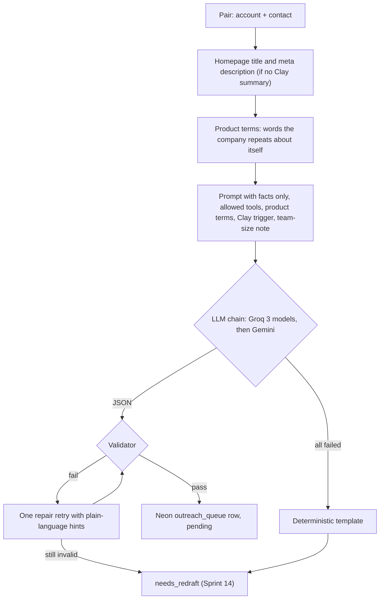

# Architecture

Twelve n8n workflows, one Google Sheet, one Neon Postgres database, a Next.js review console and a HubSpot Free CRM. The engine and its helpers read and write the Sheet. Drafts and config live in Neon, which the console reads and writes. `GTM Neon Sync` bridges the two every 15 minutes. After you approve a draft, `GTM HubSpot Sync` puts the account in HubSpot and copies deal stages back. Every hand-off between workflows is a tab or a table you can inspect and correct.

Since Sprint 15 the system works three lead tracks: `smb_direct` (the original SMB track), `agency_partner` (boutique GTM agencies from the Clay and n8n experts directories, run through the same engine) and `gig_post` (public posts where someone hires for n8n, Clay or HubSpot work, handled by `GTM Gig Finder` straight in Neon). See [Lead tracks](#lead-tracks-sprint-15).

```
                 Inputs                       n8n (Docker on your laptop)                     Stores
  seeds, YC, HN, experts ---> Personal GTM Engine (manual) ---------------------> Sheets: accounts, contacts, queues, ops
                                   |   ^                                                   |
                                   |   +--- GTM Contact Finder (manual, Tavily gate) <-----+ contacts_queue / contact_results
                                   |
                                   +--> drafts: gtm_insert_draft() ---------------> Neon: outreach_queue (system of record)
                                   +--> config: n8n_config_sheet <----------------- Neon: config_versions (console owns)
  experts = Clay and n8n experts directories (agency_partner track, Sprint 15)

  Forum mail (Gmail label gtm-gigs) --+
  Console Gigs page: Add gig ---------+--> GTM Gig Finder (first step of GTM Run; every 3 h once published)
                                            gates, score, Draft Gig Reply --> Neon: gig_posts, gig_ops,
                                                                              outreach_queue (lead_track gig_post)

  Sheets <-- GTM Neon Sync (every 15 min): pushes console vetoes, re-drafts and config, mirrors accounts, contacts, ops, config into Neon
  Neon   <-- GTM Console (Next.js on Vercel, password gate): review, approve, edit, veto, config
  Neon  <--> GTM HubSpot Sync (every 30 min): approved accounts to HubSpot, deal stages back (see HubSpot layer)

  Clay workbook "Personal GTM Engine"
    clay_queue ---------> [Accounts v2] --CSV--> clay_export_accounts --> GTM Clay Bridge --> clay_results + accounts.clay_trigger*
    clay_contacts_queue -> [Contacts Email] --CSV--> clay_export_contacts --> Clay Email Import --> contacts
    Clay Email Queue builds clay_contacts_queue. Clay Meter logs credits to clay_ops.

  Failures --> GTM Engine: Error Alerts --> Discord
```

## Workflows

| Workflow | Nodes | Trigger | Job |
|---|---|---|---|
| Personal GTM Engine | 74 | Manual | Discovery, gates, scoring, website enrichment, contact merge, drafting into Neon. Since Sprint 15 it also reads the Clay and n8n experts directories (`Partner Directories Source`) and switches on `lead_track` in the scoring, Clay, contact and drafting nodes |
| GTM Contact Finder | 13 | Manual | Founder lookup: YC page first, Tavily as a gated fallback |
| GTM Run | 10 | Manual | Run chain: GTM Gig Finder (Sprint 15, continue on error), GTM Neon Sync, Engine, Contact Finder, Engine, GTM Neon Sync. Every step hangs off the trigger and runs top to bottom (execution order v1), so the chain does not depend on what a sub-workflow returns. Fails only when accounts are queued and neither engine pass wrote a contact; otherwise returns `ok_queue_draining` and the next step (ADR-105, Sprint 14 patch). The called workflows each have a "When Executed by Another Workflow" trigger |
| GTM Gig Finder | 26 | Called by GTM Run; every 3 h once published | Sprint 15 gig lane: reads forum notification emails (`Read Forum Mail`, disabled until you add a Gmail credential) and posts added on the console Gigs page, runs `Gig Gates`, `Score Gigs` and `Draft Gig Reply`, writes `gig_posts`, gig drafts and one `gig_ops` row, expires stale posts and pings Discord for top scores (ADR-114 to 116) |
| GTM Neon Sync | 20 | Every 15 min (published) | Pushes console decisions to Sheets, then mirrors Sheets into Neon through `gtm_sync_pull()`. Since Sprint 15 it carries `lead_track` and `source_meta` |
| GTM Clay Bridge | 11 | Manual | Imports the Clay accounts export into `clay_results` (new domains) and `accounts.clay_trigger*` (all domains) |
| Clay Email Queue | 8 | Manual | Picks one primary contact per account for the Clay email waterfall, skipping accounts the drafter would skip (`v_outreach_blocks`, small team without a trigger, buying role under 60) |
| Clay Email Import | 8 | Manual | Applies Clay email results to `contacts`; never downgrades a verified email |
| Clay Meter | 5 | Manual | Reads the Clay credit balance into `clay_ops`, before and after each Clay run |
| GTM Engine: Error Alerts | 2 | Error trigger | Error workflow of the Engine and both syncs; posts failures to Discord |
| GTM HubSpot Sync | 24 | Every 30 min (published) | Reads the Neon outbox in 6 steps (companies, contacts, deals, notes, tasks, stage moves), pushes each row through `HubSpot Upsert Record`, records results with `gtm_hubspot_record()`, then pulls changed deal stages back with `gtm_hubspot_pull_stages()` |
| HubSpot Upsert Record | 11 | Called by GTM HubSpot Sync (published sub-workflow) | One record: update by HubSpot id, or search the natural key and adopt, or create with associations. Returns ok, action, id or error |

In n8n they sit in folders: `1 Core` (Engine, Contact Finder, GTM Run, Gig Finder), `2 Clay` (Bridge, Email Queue, Email Import, Meter), `3 Ops` (Neon Sync, Error Alerts), `4 CRM` (HubSpot Sync, HubSpot Upsert Record).

Each workflow sits on a real boundary: a human step (Contact Finder results, Clay runs, CSV exports), a paid-credit gate (Tavily, Clay), or an external tool. The Gig Finder is separate because gigs need a faster cadence and no Sheets or Clay (ADR-115).

## Lead tracks (Sprint 15)

One `lead_track` column on `accounts` and `outreach_queue` instead of a second project (ADR-113). Code nodes switch on it, the console filters on it (track chips on Queue and Accounts) and HubSpot receives it as `gtm_lead_track`.

| | `smb_direct` | `agency_partner` | `gig_post` |
|---|---|---|---|
| Who | SMBs that could use GTM automation | Boutique GTM agencies with overflow client work | Someone who posted a paid n8n, Clay, HubSpot or automation task |
| Source | Seeds, HN, YC | Clay experts and n8n experts directories (public pages, robots.txt allows, ADR-119) | Forum notification emails, posts you add on the console Gigs page; HN freelancer coded but off |
| Store | Sheets, mirrored to Neon | Sheets, mirrored to Neon (`source_meta` holds the directory profile) | Neon only: `gig_posts`, `gig_ops` (ADR-114) |
| Trigger | Clay or website trigger | The directory listing, dated the fetch day (ADR-117) | The post itself |
| Gates | Sprint 14 gates (ADR-103 to 111) | Tier, pricing band, language, UTC offset and stack filters; no small-team and no product-overlap gate (ADR-117) | Intent, freshness, crowding, veto words, stack match, rate floor (ADR-116) |
| Clay | Research and email waterfall | Email waterfall only, no research credits (ADR-118) | None |
| Draft | 6 SMB angles, validator v2 | 3 agency angles (`white_label_overflow`, `stack_specific_help`, `hire_bridge`), validator v3 | One reply per post (60 to 130 words), gig validator |
| HubSpot | Yes, after approval | Yes, after approval, with `gtm_lead_track` | No (`v_hubspot_scope` excludes it) |

## HubSpot layer

Neon decides what goes to HubSpot and remembers what is already there; n8n only carries the requests. Only human-approved (or sent) drafts of accounts that are not vetoed are in scope. Gig drafts are never in scope; companies and deals carry `gtm_lead_track` since Sprint 15 (`db/s15_hubspot.sql`). After a deal exists, HubSpot owns its stage and the sync copies it back. Schema: the Sprint 13 block of `db/schema.sql` (also kept as `db/s13_hubspot.sql`).

```
                         Neon (decides and remembers)                                   HubSpot Free
  outreach_queue --+                                                                   (CRM for approved work)
  accounts --------+--> v_hubspot_scope --> v_hubspot_outbox (steps 1..6, API JSON)
  contacts --------+          approved or sent,        |   ^
  config_versions -+          account not vetoed       |   |  only rows whose parents are linked,
     .hubspot                                          |   |  only changed rows, max_per_run, quarantine
                                                       v   |
  n8n (laptop)   GTM HubSpot Sync (every 30 min + manual)  |
                   Read HubSpot Config --> HubSpot Enabled? |
                     |-- 1 Companies  -->  Push --> HubSpot Upsert Record (sub-workflow) --+--> companies
                     |-- 2 Contacts   -->  Push --> (update by id | search key + adopt |   +--> contacts
                     |-- 3 Deals      -->  Push -->  create with associations)         +--> deals (stage Approved)
                     |-- 4 Notes      -->  Push -->                                    +--> notes   (on send)
                     |-- 5 Tasks      -->  Push -->                                    +--> tasks   (on send)
                     |-- 6 Stage move -->  Push -->                                    +--> deal stage Contacted
                     |        each Push --> Save --> gtm_hubspot_record() --> hubspot_links + hubspot_events
                     +-- 7 Search Changed Deals (since watermark) <------------------------ deal stages you move
                              --> Save Deal Stages --> gtm_hubspot_pull_stages()
                                    --> hubspot_links.deal_stage, outreach_queue.reply_received, console_events

  Console (Vercel) reads v_crm_status, v_hubspot_runs: CRM links, deal stage, HubSpot tab on Runs
  Failures --> GTM Engine: Error Alerts --> Discord (unchanged)
```

A re-run writes nothing: `hubspot_links` remembers every HubSpot id, and the outbox lists only rows that are new or changed. A row that fails 3 times since its last success is quarantined (`v_hubspot_quarantine`) instead of retried every run.

## Daily loop

1. Start Docker. `GTM Neon Sync` runs every 15 minutes and `GTM HubSpot Sync` every 30 minutes on their own; `GTM Gig Finder` every 3 hours once published.
2. Open the console **Gigs** page first: gig posts go stale within days. Reply to the best drafts, then mark each post Replied, Won, Lost or Dismiss as it moves.
3. Run `GTM Run` (Gig Finder, Neon Sync, Engine, Contact Finder, Engine, Neon Sync). The contact queue is topped up to 10 accounts per run.
4. Find emails for the new contacts: `Clay Email Queue` > run the waterfall in Clay by selection > export > import CSV > `Clay Email Import`. Then run `GTM Run` again: it drafts for the contacts that now have a verified email (ADR-112).
5. Open the console (phone is fine): review, edit, approve, send by hand, **Mark sent**. The track chips split SMB, agency and gig drafts.
6. Clay accounts, only when needed: run in Clay by selection > export > import CSV > `GTM Clay Bridge`. Run `Clay Meter` before and after.

Every stage is idempotent: the Data Table ledgers (`seen_accounts`, `seen_contacts`, `seen_directory_profiles`), `contact_results`, `clay_results`, the Neon `gig_posts` keys and the Neon `outreach_queue` make a re-run write nothing new.

## Stage details

### Discovery and gates

| Source | How | Free tier use |
|---|---|---|
| `seed_accounts` tab | Read every run | None |
| Hacker News "Who is hiring" | Algolia API, two latest threads, strong-keyword gate | None (public API) |
| YC company directory | Public directory by tag, active companies with a website | None (public data) |
| Apollo company search | Code node, off by default (free plan returns nothing useful) | Credits only if enabled |
| Clay experts and n8n experts directories (Sprint 15) | `Partner Directories Source`: listing pages, then each new profile once (`seen_directory_profiles`), data read from the page's embedded JSON. Rows get `lead_track = agency_partner` and `source_meta`. n8n experts is off since it answered HTTP 403 on 2026-11-16 (ADR-119) | None (public pages) |

Hard filters run before any enrichment or LLM call: domain required, employee range, industry include/exclude, keyword include/exclude, UTC offset, company type, seen-before. Each rejection reason is counted in `ops.rejection_summary`. Agency rows use the `lead_tracks.agency_partner` filters instead (excluded tiers and pricing bands, required language, UTC offsets, stack keywords); `agency_pricing` and the other agency reasons are counted the same way.

### Gig lane (Sprint 15)

The forums forbid automated access (Phase 0 spike, `scripts/s15/SPIKE.md`), so `GTM Gig Finder` never fetches them. Posts arrive two ways: the forum's own notification emails (Jobs category on Watching First Post, labelled `gtm-gigs` by a Gmail filter, read by `Read Forum Mail`), and posts you paste on the console Gigs page (`gtm_gig_add()`).

1. **Gates** (`Gig Gates`, before any LLM call, ADR-116): seen, intent (offers of service such as `[FOR HIRE]` are dropped), freshness (`gig.max_age_hours`, 72), crowding (`gig.max_replies`, 25; unknown for mailed posts), veto words, stack match, hourly rate floor (`gig.min_hourly_usd`, off). Gated posts are stored as `gated_out` with `gate_reason` and gated again next run.
2. **Score** (`Score Gigs`): `0.35 stack fit + 0.20 intent + 0.15 freshness + 0.15 competition + 0.10 budget signal + 0.05 remote fit`, plus 10 for agency or ongoing-work words, capped at 100. The breakdown is kept in `score_breakdown`.
3. **Draft** (`Draft Gig Reply`): posts at `gig.min_score` (60) or above, highest score first, at most `gig.max_drafts_per_run`. Same LLM router as Draft Outreach, gig prompt, gig validator; the signature with two portfolio links is added by code after validation. A valid draft is `pending`, otherwise `needs_redraft`. Inserting a draft moves the post to `drafted`.
4. **Ping and expire**: drafts scoring `gig.discord_ping_min_score` (75) or more ping Discord with the console link. `gtm_gig_expire()` marks posts older than twice the max age `expired` and supersedes their open drafts.
5. **Telemetry**: one `gig_ops` row per run (fetched, each gate count, scored, drafted, pinged, expired), shown on the console Runs page, Gigs tab.

### Enrichment

One GET per new account. Regex signatures detect CRM and tooling (HubSpot, Salesforce, Pipedrive, Stripe, Intercom and more) and hiring pages. Clay is a human-bridged step: n8n queues high scorers in `clay_queue`, you run `Accounts v2` in Clay by selection, export the CSV, and `GTM Clay Bridge` merges the summary and the trigger as evidence. Both Clay tables have auto-run off, so nothing spends credits by itself.

### Contact finder

1. For each queued account, guess the YC page slug and read the founders from the page's embedded JSON. Accepted only when the page lists the same website domain.
2. Accounts not on YC go to Tavily search restricted to LinkedIn profiles. Gates: the company name must be in the profile title or a current role, the location must not contradict the account's country. Name-only matches are kept as `tavily_unverified` and flagged on the draft.
3. Accounts the finder answers with no usable person (NO_RESULT, or everyone rejected) are closed (`contacts_none`), so they leave the queue.
4. Emails come later from Clay: `Clay Email Queue` picks one primary contact per account scoring 72+ (the strongest buying role), plus every guessed email for validation. It skips accounts the drafter would skip, so no credit is spent on a person who will never get a draft.

### Drafting

Sprint 14 put fixed rules in front of every LLM call. The draft path is:

blocks -> buyer role -> small-team gate -> classify -> gate or angle -> LLM -> validator -> pending | needs_redraft

1. **Blocks** (`Select Outreach Pairs`, Neon view `v_outreach_blocks`): a vetoed account, a rejected draft with scope `account` (or an older rejection with no scope), or a scope `pitch` rejection with no newer dated trigger: no new draft at that account (ADR-103).
2. **Buyer role**: `buyerScore()` ranks titles (CEO 100, ops and revenue leads 90, founder 70, technical titles 30). Under `outreach.min_buyer_score` (60): skipped. Contacts older than `outreach.max_contact_age_days` are skipped too, and a contact without a verified email waits `outreach.await_email_days` (3) for the Clay step before it can get a LinkedIn draft (ADR-112). Newest accounts first, then score plus the region bonus (ADR-109).
3. **Small-team gate**: under `outreach.small_team_no_trigger` (10) people and no valid trigger (known type, dated, or a named hiring role): skipped, re-checked next run (ADR-111). Steps 1 to 3 write nothing.
4. **Classify** (`Draft Outreach`): the homepage is always read once. Tools count only from script, embed or form hosts. Fixed keyword rules give `product_category` and `account_type`.
5. **Gate or angle**: sells GTM tooling or is hardware: a visible `rejected` row with scope `account` and provider `gate:product_overlap` or `gate:hardware`, unless the account is in `outreach.gate_overrides` (ADR-106). Otherwise code picks 1 of 6 angles (hire_bridge, delivery_ops, client_reporting, demo_brief, booking_followup, signup_activation) with its basis; none fits: `rejected`, scope `pitch`, provider `gate:no_angle` (ADR-107).
6. **LLM** writes the chosen angle only. The stored `angle` and `trigger` are set by code afterwards.
7. **Validator** (rules below, plus v2: `unpunctuated_end`, `copied_source`). A template draft, or one still invalid after the repair retry, goes to `needs_redraft`, outside the Review tab (ADR-108). Only a valid LLM draft is `pending`.

The flowchart below is the LLM part (steps 6 and 7).



On the agency track (ADR-117) code picks one of 3 angles (`white_label_overflow`, `stack_specific_help`, `hire_bridge`), the small-team and product-overlap gates are skipped, and validator v3 adds three rules: name one of their services outside my own proof sentence, offer one small first task, no seniority claims.

Validator rules (deterministic): word counts per field, LinkedIn note length, follow-up lengths, company named in the first line, no links or placeholders, no money or percentages, no invented numbers, tool whitelist (only tools detected on the company's site), no first-person claims about the recipient, no partnership pitch, hedged statements only, no "which means" conclusions, no "ops team" at companies of 20 or fewer, and no product terms outside the observation. Every rejection reason lands in `risk_notes` so a reviewer sees why a draft needed a retry.

### Human in the loop

Nothing is sent by the system. The console shows each draft with everything needed to decide: account, contact, email status, why it matched, angle, pain point, value proposition, Clay summary and trigger, tech stack, score breakdown, LinkedIn note, long message, three follow-ups and risk flags. You approve, edit, reject or re-draft, send by hand, then **Mark sent**. A veto on the account page sets the account to `rejected`; the next sync writes that status to the Sheet, where the engine and Contact Finder skip rejected accounts.

The console writes only through three Postgres functions: `gtm_review` (approve, reject, reopen, save edits, mark sent, re-draft), `gtm_veto_account` and `gtm_save_config`. Each one checks the state transition and logs to `console_events`. Vetoes, re-drafts and config changes reach the Sheet on the next sync.

## Rate limits and pacing

| Provider | Handling |
|---|---|
| Groq | 6 s between drafts, 429 waits up to 20 s using `retry-after`, longer waits put that model on cooldown and the next model takes over |
| Gemini | Second provider in the chain, same handling |
| Tavily | 1 request per 1.2 s, YC lookup first so most accounts cost 0 credits |
| Partner directories | 1.5 s between requests (`sources.partner_directories.politeness_ms`), each profile fetched once, at most `max_profiles_per_run` new profiles per run |
| Forums | No requests: posts arrive as the forum's own emails, read from your Gmail |
| Clay | Run by selection only, auto-run off, metered before and after by `Clay Meter` |
| Google Sheets | Every read node uses Execute Once; writes are batched. The sync reads 4 tabs per run |
| HubSpot | `max_per_run` caps every outbox step; the sub-workflow retries 3 times, 2 s apart. Free limits: 100 requests per 10 s, 250,000 per day |
| Discord | Workflow failures, plus one ping per hot gig draft |

See [ADR.md](ADR.md) for the reasoning behind each decision and [SHEET_SCHEMA.md](SHEET_SCHEMA.md) for every tab.
