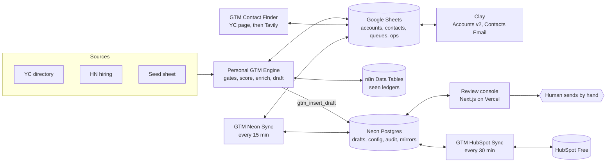

# SPEC: Personal GTM Engine

**Project type:** Personal GTM / outbound company discovery, contact enrichment, grounded drafting, human review and CRM hand-off
**Owner:** Mohamed Landolsi
**Version:** v2.0 (as built)
**Status:** Complete. Sprints 1 to 13, refactor sprints R1 and R2, and Sprint 7 patches 1 to 5 are done.
**Last updated:** 2026-10-28
**Constraint:** Zero cost (free tiers only), human approval before any outreach, no dependency on Job Radar
**Links:** [Repository](https://github.com/mohamedlandolsi/personal-gtm-engine) · [Portfolio case study](https://www.mohamedlandolsi.tech/work/personal-gtm-engine)

> v1.0 (2026-09) was the design spec. v2.0 records what was actually built. Where the build changed the plan, the change and the ADR behind it are listed in section 0. Detailed docs live in the repo: `docs/ARCHITECTURE.md`, `docs/SHEET_SCHEMA.md`, `docs/SETUP.md`, `docs/ADR.md` (87 decisions).

---

## 0. What changed from v1.0

| Area | v1.0 plan | As built (v2.0) | Why (ADR) |
|---|---|---|---|
| Discovery | Apollo company search as primary source | YC public directory (primary), Hacker News "Who is hiring" (behind a strong-keyword gate), seed sheet. Apollo built but off | Apollo free plan returned nothing useful (ADR-060, 061, 063) |
| Enrichment | Apollo + optional Clay | Website fetch with regex signatures, then a metered Clay layer: structured AI summary, dated trigger signal, Work Email waterfall | Deterministic first, Clay only on survivors (ADR-014, 017, 089) |
| People | Apollo person search, Hunter, Clay | YC company page first (verified by domain), Tavily search as gated fallback, manual sourcing as last resort | People databases were plan-gated; YC pages are free and verifiable (ADR-025, 066, 076) |
| Email | Apollo, Hunter, Clay, LLM guess | Clay Work Email waterfall with Conservative validation; guessed emails capped at `guessed` | Guessed is not verified (ADR-022, 053) |
| LLM chain | Groq, Gemini, OpenRouter free, template | 3 Groq models on one key, then Gemini, then a deterministic template, with a rule-based validator and one repair retry | Pacing and capacity fixed first (ADR-071, 072, 042) |
| Review | Approval columns in Sheets + Discord digest | Private Next.js console on Vercel backed by Neon Postgres. Discord digest retired; Discord kept for error alerts only | One review surface with an audit log (ADR-082, 083) |
| State | Google Sheets only | Three stores: Sheets (engine working store), Neon Postgres (drafts, config, audit, mirrors), n8n Data Tables (dedupe ledgers) | Strangler migration, no big-bang rewrite (ADR-086) |
| Config | `config` sheet tab | Versioned config in Neon (`config_versions`), edited and validated in the console; Sheet tab is a mirror | Validation, versions and a diff trail |
| CRM | "HubSpot free later" | HubSpot Free: approved accounts synced as company, contact, deal; send logs a note and a task; deal stages flow back | Neon outbox, n8n as transport (ADR-090 to 102) |
| Scheduling | Daily 08:00 schedule | Engine runs on demand; Neon Sync every 15 min and HubSpot Sync every 30 min while n8n runs | Volume too low for an always-on host (ADR-049) |
| Scoring weights | 5 components from the start | 4 components at discovery, 5 after contacts (feasibility added) | Contacts arrive later in the lifecycle (ADR-021) |

---

## 1. Project mission

An independent outbound engine that discovers B2B startups, agencies and SMBs likely to need a **GTM Automation / Integration / RevOps Engineer**, and outputs for each one:

1. **Account:** name, domain, size, industry, location, timezone fit, explainable 0 to 100 score, reasons, red flags, tech stack, Clay summary and a dated "why now" trigger.
2. **Decision-maker:** a verified founder or functional lead, title, LinkedIn, email with verification status and source.
3. **Outreach draft:** angle, pain point, value proposition, proof point, LinkedIn note, long message and three follow-ups, grounded in stated facts only.
4. **Review and CRM trail:** every draft is approved, edited, rejected or vetoed by a human in the console; approved work lands in HubSpot.

All targeting rules are configurable at runtime without editing workflows.

## 2. Core objective

Find organizations that are:

- Small enough to respond to a remote contractor.
- Mature enough to pay for external automation help.
- Likely to need GTM automation, RevOps, integration, enrichment, CRM clean-up or AI-assisted sales operations.
- In a compatible timezone (UTC+0 to UTC+4).
- Reachable through public business contact data.

This is an **outbound opportunity discovery engine**, not a job application engine.

## 3. Non-goals (still true)

- No automatic sending of email or LinkedIn messages. The system has no send path.
- No LinkedIn automation of any kind.
- No scraping of private or authenticated pages.
- No paid data providers.
- No replacement of a CRM: HubSpot holds approved work; the engine does not try to be a CRM.
- No claim of verified funding or hiring intent; only proxies and sourced triggers.

## 4. Relationship to Job Radar

| System | Purpose | Object | Output |
|---|---|---|---|
| Job Radar | Find job postings matching Mohamed | Job posting | Ranked job matches |
| Personal GTM Engine | Find companies likely to need GTM automation | Account + contact + draft | Reviewed outreach + CRM records |

Fully separate: own workflows, own Sheet, own config. Verified in Sprint 12 (Job Radar uses its own sheet).

## 5. Primary user

Mohamed Landolsi, single owner and reviewer. Goals: qualified accounts to pitch, the right person to contact, a grounded first message, less manual research, and a portfolio-grade GTM engineering artifact.

## 6. Success metrics: target vs actual

Actuals from the engine's own telemetry in Neon (`ops`, `outreach_queue`, `console_events`, `sync_ops`, `hubspot_events`), October 2026.

| Metric | Definition | Target | Actual | Verdict |
|---|---|---|---|---|
| Account match rate | Passing gates / discovered | ≥ 20% | YC 23 of 377 (6%), HN 14 of 495 (3%) | Below target by design: strict timezone gate and strong-keyword gate cut noise before any spend |
| Qualified rate | Accounts scoring 65+ and not rejected / accounts written | n/a | 43 of 49 (88%) | Gates do the filtering, scoring confirms |
| Email found rate | Contacts with a verified email / contacts | ≥ 30% | 37 of 67 (55%) | Met |
| Waterfall hit rate | Founders verified by Clay / founders sent | n/a | 19 of 20 (95%), about 0.46 credit each | Met |
| Outreach readiness | Live drafts ready for review | ≥ 25 per week | 42 live drafts (72 written, 30 superseded), 7 approved | Volume capped on purpose (`max_per_day = 10`, LinkedIn note limits) |
| Draft quality | Drafts passing the validator without template | n/a | 8 of 8 in the latest run | Met |
| False positive rate | Rejected / reviewed | < 25% | Not measured as defined (17 review actions logged) | Open |
| Cost | Paid spend | $0 | $0 | Met |
| HITL compliance | Messages sent without approval | 0 | 0 | Met |
| Idempotency | Rows written by a second identical run | 0 | 0 (engine, Neon Sync, HubSpot Sync) | Met |

## 7. Scope

### Delivered

Dynamic config with versions · three pluggable discovery sources · normalization and domain dedupe · deterministic hard filters before any spend · website enrichment · metered Clay layer (summary, trigger, email waterfall) · founder lookup with verification · explainable account and contact scoring · grounded LLM drafting with validator and template fallback · review console with audit log · Sheets to Neon sync · HubSpot sync with stage pull-back · run telemetry for every workflow · failure alerts to Discord · public repo with sanitized exports.

### Out of scope

Automatic sending · LinkedIn automation · automatic reply detection (replies are recorded by moving the HubSpot deal stage) · meeting booking · multi-language outreach · paid providers · always-on scheduling of the engine.

## 8. Target account profile (ICP)

| Dimension | Rule |
|---|---|
| Company type | Startup, SMB, agency (enterprise off) |
| Size | 2 to 150 employees; small-team threshold 50 (founder preferred below it) |
| Industries in | B2B SaaS, software, fintech, healthtech, fitness tech, marketing / sales agency, RevOps and GTM consulting, marketing automation, AI software |
| Industries out | Recruiting, staffing, adult, gambling, crypto trading, MLM, dating, political campaigns |
| Need keywords | automation, integration, revops, gtm, sales / marketing operations, crm, hubspot, salesforce, clay, n8n, make.com, zapier, lead / demand generation, b2b, saas, ai workflows |
| Veto keywords | German / French required, must be based in USA, security clearance, competitors ("workflow engine", "n8n alternative", "zapier alternative") |
| Timezone | UTC+0 to UTC+4; unknown allowed (ADR-058) |
| Vertical boost | +5 for fitness, health, wellness, gym, training, hypertrophy, sports tech |

Budget is never claimed, only estimated from proxies (size, stage, B2B model, detected CRM, active website, hiring page).

## 9. Dynamic configuration

| Item | As built |
|---|---|
| Owner | Neon `config_versions`: every save is a new row with `rev`, raw text, parsed JSON (invalid JSON is rejected by a generated column), note and author |
| Editing | Console Config page: JSON editor, switches, diff against the active version, saved through `gtm_save_config()` |
| Reading | Every n8n `Fetch Config` node reads the `n8n_config_sheet` view in Neon |
| Mirror | `config` Sheet tab, pushed by `GTM Neon Sync` (readable backup and drift check) |
| Fresh install | Paste `config/config.example.json` into `config!B2`; the first sync imports it into Neon |

## 10. Configuration schema (top-level keys)

Full live example: `config/config.example.json`.

| Key | Controls | Live defaults |
|---|---|---|
| `rev`, `enabled` | Version label written to `ops`, global kill switch | `personal-gtm-sprint7-quality2`, `true` |
| `max_companies_per_run`, `min_account_score`, `priority_score` | Write cap and score thresholds | 25, 60, 80 |
| `allow_*` | Company types | agencies, startups, SMB on; enterprise off |
| `timezone` | Allowed UTC offsets, unknown policy | `[0..4]`, unknown allowed |
| `company` | Size range, domain rule, include / exclude lists | 2 to 150, domain required |
| `scoring` | Weights and vertical boost | 0.35 / 0.25 / 0.25 / 0.15, boost +5 |
| `enrichment` | Website fetch caps | 15 rows, 8 s timeout, 800 ms politeness |
| `clay` | Account handoff to Clay | 6 rows per run, min score 65 |
| `contact` | Contact gates, excluded roles, generic email prefixes | 10 accounts per run, min contact score 60 |
| `contact_finder` | Tavily search | 10 accounts per run, 8 results, LinkedIn only |
| `clay_contacts` | Email waterfall handoff | 6 rows per run |
| `outreach` | Draft gates, caps, CTA, proof points, word range, LLM chain | account 65+, contact 70+, 8 pairs per run, 10 per day, 1 contact per account, 70 to 120 words |
| `outreach.llm` | Provider chain, timeouts, pacing | see section 28 |
| `sources` | `apollo`, `hn_hiring`, `yc_directory` switches and queries | Apollo off, HN on (400 cap), YC on (300 cap) |
| `hubspot` | CRM sync switch, `max_per_run`, contact legal basis | see section 34 |
| `digest` | Retired Discord digest | `false` |

## 11. System architecture



### Workflows (10 active, 1 retired)

| Folder | Workflow | Nodes | Trigger | Job |
|---|---|---|---|---|
| 1 Core | Personal GTM Engine | 59 | Manual | Discovery, gates, scoring, website enrichment, contact merge, drafting into Neon |
| 1 Core | GTM Contact Finder | 13 | Manual | Founder lookup: YC page, then Tavily (gated) |
| 2 Clay | GTM Clay Bridge | 11 | Manual | Imports Clay account export into `clay_results` and `accounts.clay_trigger*` |
| 2 Clay | Clay Email Queue | 7 | Manual | Picks one primary contact per account for the waterfall |
| 2 Clay | Clay Email Import | 8 | Manual | Applies Clay emails; never downgrades a verified email |
| 2 Clay | Clay Meter | 5 | Manual | Reads Clay credit balance into `clay_ops` before and after runs |
| 3 Ops | GTM Neon Sync | 15 | Every 15 min | Console decisions to Sheets; Sheets mirrored into Neon via `gtm_sync_pull()` |
| 3 Ops | GTM Engine: Error Alerts | 2 | Error trigger | Posts failures of the Engine and both syncs to Discord |
| 4 CRM | GTM HubSpot Sync | 24 | Every 30 min | Neon outbox to HubSpot in 6 steps, deal stages back |
| 4 CRM | HubSpot Upsert Record | 11 | Sub-workflow | Update by id, or search natural key and adopt, or create with associations |
| retired | Personal GTM Digest | | | Discord review cards (Sprint 7 to 11), replaced by the console |

Workflow boundaries follow human steps and credit gates (ADR-087).

## 12. Functional requirements

| ID | Requirement | Status | Where |
|---|---|---|---|
| FR-01 | Read all targeting rules from config at runtime | Done | Neon `config_versions` via `n8n_config_sheet` |
| FR-02 | No dependency on Job Radar | Done | Separate workflows and sheet |
| FR-03 | Pluggable discovery through one normalized schema | Done | Source contract: mapper, kill switch, per-source telemetry (ADR-051) |
| FR-04 | Normalize every company before filtering | Done | `Normalize` stage |
| FR-05 | Deduplicate by domain | Done | `seen_accounts` Data Table |
| FR-06 | Deterministic filters before enrichment, LLM or paid calls | Done | `Process Accounts`, counted in `ops.rejection_summary` |
| FR-07 | Cap companies per run | Done | `max_companies_per_run` and per-stage caps |
| FR-08 | Enrich survivors | Done | Website fetch + Clay layer |
| FR-09 | Find up to N contacts per account | Done | Contact Finder, `max_contacts_per_company = 3` |
| FR-10 | Prefer founders for small teams | Done | `small_team_threshold = 50` |
| FR-11 | Explainable account and contact scores | Done | `score_breakdown`, `why_match`, `red_flags` |
| FR-12 | Generate outreach drafts for qualified pairs | Done | `Draft Outreach` |
| FR-13 | Every draft has an approval status | Done | Neon `outreach_queue.approval_status`, DB-enforced |
| FR-14 | Every run writes telemetry | Done | `ops`, `sync_ops`, `hubspot_events`, `clay_ops`, `console_events` |
| FR-15 | A failed source does not kill the run | Done | Typed error markers, `source_errors` |
| FR-16 | Review, edit, approve, reject, re-draft and veto in a private console | Added S10 | Console Queue and Accounts pages |
| FR-17 | Every human decision is audited; invalid transitions are refused by the database | Added S10 | `gtm_review`, `gtm_veto_account`, `console_events` |
| FR-18 | Config edits are validated, versioned and diffable | Added S10 | `gtm_save_config`, Config page |
| FR-19 | Founder identity is verified before drafting | Added S7 P4 | YC domain match, Tavily company and location gates, `tavily_unverified` flag |
| FR-20 | Every draft passes a deterministic validator | Added S7 P3 | Validator rules, section 27 |
| FR-21 | Every Clay credit is metered | Added S9 | `Clay Meter` before / after pairs in `clay_ops` |
| FR-22 | Each hot account carries one dated, sourced trigger | Added S11 | `accounts.clay_trigger`, `_source`, `_date` |
| FR-23 | Approved accounts sync to the CRM; deal stages sync back | Added S13 | `GTM HubSpot Sync`, `gtm_hubspot_pull_stages()` |
| FR-24 | Workflow failures alert the owner | Added R2 | `GTM Engine: Error Alerts` |

## 13. Non-functional requirements

| ID | Requirement | Status |
|---|---|---|
| NFR-01 | $0 paid spend | Met: n8n self-hosted, Neon Free, Vercel Hobby, HubSpot Free, free LLM tiers, Clay trial |
| NFR-02 | No outreach without human approval | Met: no send node exists; **Mark sent** only on approved drafts |
| NFR-03 | Deterministic gates before LLM or paid calls | Met |
| NFR-04 | Config changes without workflow edits | Met |
| NFR-05 | No repeated company, contact, draft or CRM rows | Met: ledgers, `gtm_insert_draft()`, `hubspot_links` |
| NFR-06 | Provider failures captured in telemetry | Met: `risk_notes`, `llm_failures`, `hubspot_events` |
| NFR-07 | Output reviewable by a human | Met: console (desktop two-pane and 390 px phone) |
| NFR-08 | Portable to self-hosted n8n | Met: sanitized exports and `docs/SETUP.md` |
| NFR-09 | No LinkedIn automation | Met |
| NFR-10 | Public business data only | Met |
| NFR-11 | Re-runs are no-ops | Met: second run writes 0 |
| NFR-12 | GDPR legal basis on every CRM contact | Met: `hs_legal_basis` (ADR-102) |
| NFR-13 | No secrets in the repo | Met: `scripts/sanitize_workflows.py` refuses to write keys or webhooks (ADR-079) |

## 14. Discovery sources (as built)

| Source | How | Status |
|---|---|---|
| YC company directory | Free yc-oss JSON feed by tag (`sales`, `marketing`, `crm`, `sales-enablement`, `workflow-automation`); real headcount, location and tags | Primary, on |
| Hacker News "Who is hiring" | Algolia API, 2 latest threads, cap 400, whole-word strong-keyword gate, ATS and noise hosts stripped | On |
| `seed_accounts` tab | Hand-picked targets, read every run | On |
| Apollo company search | Code node with internal fetch and typed errors, 3 config queries | Built, off until a 1-credit pilot passes (ADR-060) |

Rejected: job-board APIs (ADR-059), paid data.

## 15. Normalized company schema

Unchanged from v1.0 (`account_id`, `source`, `company_name`, `domain`, `website`, `industry`, `company_type`, `employee_count`, `location_raw`, `country`, `timezone_utc_offset`, `funding_stage`, component scores, `final_score`, `why_match`, `red_flags`, `confidence`, `status`). The full 33-column `accounts` header, including enrichment, Clay and contact columns, is in `docs/SHEET_SCHEMA.md`.

## 16. Deterministic hard filters

Reject when: no name, no domain (`must_have_domain`), size outside 2 to 150, excluded industry, excluded keyword, disallowed company type, UTC offset outside the allowed list, inactive company (YC), duplicate within the run, or already in `seen_accounts`. Every rejection reason is counted in `ops.rejection_summary`.

Example (YC run, 2026-10-08): 377 in, 234 timezone, 86 inactive, 27 size, 5 duplicate tags, 2 no website, **23 to scoring**.

## 17. Enrichment

### 17.1 Website layer ($0)

One GET per new account (cap 15, 8 s timeout). Regex signatures on raw HTML detect CRM (HubSpot, Salesforce, Pipedrive, Close, Attio, Zoho), automation (Zapier, Make, n8n, Clay, Apollo, Workato), analytics, CMS, Stripe, Intercom, hiring and contact pages. Results upgrade `funding_proxy_score` and `automation_need_score` and set `enrichment_status = enriched | enrich_failed`. Never re-enriched (cache rule).

### 17.2 Clay layer (metered)

| Module | Clay table | What | Unit cost |
|---|---|---|---|
| C1 Research | `Accounts v2` | `company_enrich` + one structured AI research column (was 3 Claygent columns), facts from the homepage and linked pages only | 1.0 credit per row (was 2.8) |
| Trigger signals | `Accounts v2` | Job openings, then funding, then news; one dated, sourced trigger per account | about 0.9 credit per row |
| C2 Email waterfall | `Contacts Email` | Work Email waterfall, Conservative validation; `find` and `verify` modes | about 0.46 credit per verified email |

Rules: only accounts that passed gates and score 65+ reach Clay; pilot 2 rows before any batch (ADR-017); auto-run off, runs by selection; `Clay Meter` before and after every run; human-bridged CSV hand-off (ADR-015); merge is evidence-only and never overwrites verified data (ADR-016). Currency symbols in funding triggers are rewritten as number plus code so the validator stays strict (ADR-S11-7).

Trial outcome: about 50 credits spent on data the engine reads; the rest of the trial allowance was left to expire on purpose (ADR-S11-SD1). Clay now runs on the Free plan with two tables (ADR-089).

## 18. Budget proxy model

Estimated, never claimed. Positive: 5 to 100 employees, seed / Series A, B2B SaaS model, agency with clients, detected CRM or sales stack, active website, hiring page. Negative: 0 to 1 employees, no website, recruiting / staffing, non-B2B local business. Output: `funding_proxy_score` 0 to 100 with reasons. Weights live in the `Process Accounts` and `Score Enriched` nodes; the code is the source of truth.

## 19. Automation need model

Positive: mentions RevOps / GTM / sales ops, detected HubSpot / Salesforce / Pipedrive, detected Clay / n8n / Make / Zapier, agency managing clients, B2B sales motion, AI workflows. Negative: no sales motion, pure content site, non-B2B, no digital presence. Output: `automation_need_score` 0 to 100 with reasons.

## 20. Timezone model

Deterministic country-to-UTC table (ADR-052), no LLM geo inference. Allowed offsets 0 to +4. Unknown timezone is allowed (`allow_unknown_timezone = true`) because HN posts rarely state one; unknown scores 0 on the timezone component (ADR-058).

## 21. Account scoring

Two phases, both written to `score_breakdown`:

```text
Phase 1 (discovery and enrichment, 4 components):
final = 0.35*icp + 0.25*budget + 0.25*automation + 0.15*timezone (+5 vertical boost), clamp 0..100

Phase 2 (after contacts, 5 components, ADR-021):
final = 0.30*icp + 0.20*budget + 0.20*automation + 0.15*timezone + 0.15*feasibility (+5), clamp 0..100
feasibility = highest contact_score for the account
```

| Threshold | Value | Effect |
|---|---|---|
| Write floor | 60 | Account written to `accounts` |
| Spending gates | 65 | Contacts, Clay and drafting |
| Email waterfall | 72 (primary contacts) | Clay email queue |
| Priority / hot | 80 | `priority = true`, trigger signals |

## 22. Contact discovery (as built)

```text
contacts_queue
  1. YC company page: founders read from embedded JSON, accepted only if the page lists the same website domain   (0 credits)
  2. Tavily search, LinkedIn profiles only, 1 request per 1.2 s:
       company name must be in the profile title or current role
       location must not contradict the account's country
       name-only match is kept as tavily_unverified and flagged on the draft
  3. Manual sourcing into contact_results (provider = hitl_manual)
  A NO_RESULT row stops the domain being searched again. Rejected accounts are skipped.
```

Role priority: founders, co-founders, CEO and CTO for teams of 50 or fewer; RevOps, sales ops, marketing ops, sales and growth leads above that. Excluded: recruiter, talent acquisition, HR, people ops, intern, and generic inboxes (`info@`, `jobs@`, ...). Wrong people are set to `rejected`, never deleted (ADR-023). Results: 19 founders verified from YC pages at 0 search credits; 10 of 10 lookups resolved after the name-matching fix.

## 23. Contact schema

v1.0 fields plus `contact_key` and `account_domain` (dedupe). `contact_results.provider` is one of `yc_directory`, `tavily_search`, `tavily_unverified`, `hitl_manual`.

## 24. Contact scoring

```text
contact_score = 0.35*role_authority + 0.25*relevance + 0.20*email_confidence + 0.10*linkedin + 0.10*timezone_fit
```

Email confidence: verified 100, guessed 30 (cap, ADR-022), not found 0. Contacts below `min_contact_score` (60) are rejected; drafting needs 70+.

## 25. Email enrichment

`Clay Email Queue` sends one primary contact per account scoring 72+ (`find`) and every guessed email (`verify`). Clay's Work Email waterfall runs with Conservative validation. `Clay Email Import` writes results back and never downgrades a verified email. Result: 19 of 20 founders verified, 4 of 4 guessed emails confirmed, 11.7 credits.

## 26. Outreach generation

Gate: account score 65+, contact score 70+, account not rejected, no live draft for the contact (ADR-056), max 1 contact per account (ADR-075), max 8 pairs per run and 10 per day.

Channel (ADR-038): `email` only when `email_status` is verified or valid; otherwise `linkedin_manual` if a LinkedIn URL exists; otherwise skip.

Facts given to the model: account fields, Clay summary or homepage title and meta description, detected tools, product terms, Clay trigger, team-size note, one proof point. Drafts are written to Neon through `gtm_insert_draft()` and start as `pending`.

`outreach_queue` columns (Neon): `outreach_id`, `run_date`, `account_id`, `contact_id`, `company_name`, `contact_name`, `channel`, `angle`, `trigger`, `pain_point`, `value_proposition`, `proof_point`, `cta`, `email_subject`, `first_line`, `message_draft`, `follow_up_1..3`, `linkedin_note`, `risk_notes`, `approval_status`, `send_status`, `sent_at`, `reply_received`, `notes`, `llm_provider`, `llm_calls`, `llm_failures`, `reviewed_at`.

## 27. Outreach rules and validator

- The model writes `first_line` and `body_rest` only; code adds greeting, the exact config CTA and sign-off (ADR-037).
- Cold message 70 to 120 words; LinkedIn note within the free-account limit; each follow-up shorter than the last.
- Deterministic validator (ADR-039, 043, 024, 026): word counts per field, company named in the first line, no links or placeholders, no money or percentages, no numbers absent from the facts, tool whitelist (only tools detected on the site), no first-person claims about the recipient, no partnership pitch, hedged statements only, no "which means" conclusions, no "ops team" at 20 people or fewer, no product terms outside the observation ("their product is not their problem").
- A failed draft gets one repair retry with the rejection reason, then falls through to the next provider (ADR-042). Every rejection reason is stored in `risk_notes`.
- Replaced drafts are `superseded`, never deleted (ADR-040).

## 28. LLM usage

```text
groq: openai/gpt-oss-120b  ->  groq: qwen/qwen3.8-27b  ->  groq: openai/gpt-oss-20b  ->  gemini  ->  deterministic template
```

Temperature 0.3, JSON only, 40 s timeout, 1,500 max output tokens, 6 s between drafts, `retry-after` honored up to 20 s, longer waits put the model on cooldown. The router is one Code node driven by `outreach.llm.chain` (ADR-034, 041). The template always writes a row (ADR-035, 073). OpenRouter is not in the chain; Mistral was tried and dropped because its API needs a paid plan.

## 29. Clay usage policy

Clay is an enrichment worker, never the orchestrator (ADR-002). n8n decides which rows go to Clay and what comes back. No credits on unfiltered, rejected, dead or un-enriched rows. Auto-run off, run by selection, metered before and after, pilot before batch. People search in Clay was plan-gated and is not used.

## 30. Data model

| Store | Holds | Owner |
|---|---|---|
| Google Sheet `personal-gtm-engine` (13 tabs) | `config` (mirror), `seed_accounts`, `accounts`, `contacts_queue`, `contact_results`, `contacts`, `clay_queue`, `clay_export_accounts`, `clay_results`, `clay_contacts_queue`, `clay_export_contacts`, `ops`, `clay_ops` | n8n workflows |
| Neon Postgres (`db/schema.sql`) | `outreach_queue` (system of record), `config_versions`, `console_events`, `console_settings`, `sync_ops`, mirrors of `accounts`, `contacts`, `ops`; HubSpot layer `hubspot_links`, `hubspot_events` and outbox views | Console, Neon Sync, HubSpot Sync |
| n8n Data Tables | `seen_accounts`, `seen_contacts` | Engine |

Sheet rules: never delete columns, hide them (append nodes re-create missing columns, ADR-085); archive before delete (ADR-084). Sprint 12 cut the Sheet from 20 tabs to 13. Every tab's header, writer and reader: `docs/SHEET_SCHEMA.md`.

## 31. Deduplication and idempotency

| Object | Key | Mechanism |
|---|---|---|
| Account | normalized domain (`https://www.x.com/` to `x.com`) | `seen_accounts` Data Table |
| Contact | email, else LinkedIn URL, else name + domain | `seen_contacts` Data Table |
| Lookup | domain | `contact_results` (`NO_RESULT` row stops repeats) |
| Clay result | domain | `clay_results` |
| Draft | contact | non-superseded rows of Neon `outreach_queue`, `gtm_insert_draft()` |
| CRM record | link type + local id | `hubspot_links`, natural-key search, unique `gtm_account_key` property |

## 32. Status lifecycle

| Field | Values |
|---|---|
| `accounts.status` | `new`, `contact_found`, `contacts_none`, `rejected` (by you or a console veto) |
| `contacts.status` | `new`, `used_in_outreach`, `rejected` |
| `outreach_queue.approval_status` | `pending`, `approved`, `edited` (must be re-approved), `rejected`, `superseded` |
| `outreach_queue.send_status` | `not_sent`, `sent` (approved drafts only), `bounced` |
| HubSpot deal stage | `Approved` on create, `Contacted` after **Mark sent**, any later stage moved by hand in HubSpot flows back; a reply stage sets `reply_received` |

## 33. Review console (replaces the Discord digest)

| Item | As built |
|---|---|
| Stack | Next.js 16 on Vercel Hobby (Frankfurt), Neon Postgres, single-owner password gate (anonymous requests get 307 to `/login`) |
| Pages | **Queue** (desktop two-pane, works at 390 px), **Draft** (account, contact, email status, why matched, angle, Clay summary and trigger, tech stack, score ledger, note, message, follow-ups, risk flags), **Accounts** (detail and veto), **Config** (editor, switches, diff), **Runs** (engine, sync and HubSpot runs, sync health) |
| Actions | approve, reject, reopen, save edits, re-draft, mark sent, veto account |
| Write path | Only through `gtm_review`, `gtm_veto_account`, `gtm_save_config`; each checks the transition and logs to `console_events` |
| CRM status | Each draft shows its HubSpot record links and deal stage (`v_crm_status`) |

History: Sprints 7 to 11 used a scheduled Discord digest with one card per draft and approval in the Sheet. Retired in Sprint 12 (ADR-082); the export is kept in `workflows/retired/`.

## 34. CRM layer (HubSpot Free)

| Item | As built |
|---|---|
| Scope | Only approved or sent drafts of accounts that are not vetoed (`v_hubspot_scope`); Neon stays the system of record (ADR-090) |
| Pattern | Transactional outbox: `v_hubspot_outbox` builds API payloads in 6 ordered steps (companies, contacts, deals, notes, tasks, stage moves); n8n carries them; `gtm_hubspot_record()` records results. Zero Code nodes (ADR-093) |
| Auth and API | Service Key (legacy private apps were switched off on 2026-10-26), HTTP Request on date-versioned `2026-09` endpoints (ADR-091, 092) |
| Idempotency | Link table first, natural-key search second (domain, verified email, deal name), unique `gtm_account_key` (ADR-094) |
| Ownership | Engine owns the company and contact fields it sends; HubSpot owns the deal after creation; the sync never deletes (ADR-095, 098) |
| Custom properties | `gtm_account_key`, `gtm_score`, `gtm_trigger`, `gtm_email_status`; LinkedIn uses built-in `hs_linkedin_url` (ADR-097) |
| On send | A note and a follow-up task are logged and the deal moves to Contacted |
| Pull-back | Changed deal stages since a watermark, every 30 min, via `gtm_hubspot_pull_stages()`; reply stage marks drafts replied and logs `crm_reply` (ADR-096, 099) |
| Failure | A row failing 3 times since its last success is quarantined (`v_hubspot_quarantine`) (ADR-100) |
| Compliance | `hs_legal_basis` on every contact, default "Legitimate interest - prospect/lead" (ADR-102) |
| Operator | The Claude HubSpot connector reads, audits and may move one deal stage on explicit request (ADR-101) |
| Result | 7 companies, 7 contacts, 7 deals; a second run writes 0 |

## 35. Ops telemetry

| Table | Written by | Shows |
|---|---|---|
| `ops` (Sheet, mirrored to Neon) | Engine | One row per run: source counts, gates, `rejection_summary`, enrichment, Clay, contacts, drafts, LLM calls and failures, warnings, errors |
| `sync_ops` | Neon Sync | Pushed and pulled counts, config state, duration |
| `hubspot_events` | HubSpot Sync | Every push attempt and stage pull: created, updated, adopted, failed |
| `console_events` | Console functions | Every human decision with before and after |
| `clay_ops` | Clay Meter | Credit balance before and after each Clay run |

All are visible on the console Runs page. Debugging starts there, never with a blind rewrite.

## 36. Error handling

| Failure | Behavior |
|---|---|
| Source down or plan-gated | Typed error marker, logged in `source_errors`, run continues with other sources |
| Website unreachable | `enrich_failed` with a red flag, run continues |
| No contact found | `NO_RESULT`, `contacts_none`, no further spend |
| LLM 429 or timeout | `retry-after` wait, cooldown, next model, then template |
| Draft fails validator | One repair retry, then next provider; reasons in `risk_notes` |
| HubSpot push fails | Retry 3 times 2 s apart in the sub-workflow, logged; quarantine after 3 failed runs |
| Any workflow error | `GTM Engine: Error Alerts` posts to Discord |

## 37. Rate limits and pacing

| Provider | Handling |
|---|---|
| Groq | 6 s between drafts, `retry-after` up to 20 s, cooldown on longer waits |
| Gemini | Second provider, same handling |
| Tavily | 1 request per 1.2 s; YC lookup first so most accounts cost 0 credits |
| Clay | By selection only, auto-run off, metered |
| Google Sheets | Execute Once on every read, batched writes; the sync reads 4 tabs per run |
| HubSpot | `max_per_run` per outbox step; free limits 100 requests per 10 s, 250,000 per day |
| Discord | Failures only |

## 38. Security, privacy and compliance

Not legal advice. Public business contact data only; no authenticated scraping; no sending by the system; no emails in Discord (ADR-047); secrets in n8n environment variables and credentials only; Google Sheets through a service account; public repo uses sanitized exports only (ADR-079); console behind a password gate; GDPR legal basis recorded on every HubSpot contact; low volume by design; honest identity and no fabricated claims (validator).

## 39. Technology stack

| Layer | Tool | Plan |
|---|---|---|
| Orchestration | n8n, self-hosted in Docker | Free |
| State | Google Sheets (service account), Neon Postgres, n8n Data Tables | Free |
| Review | Next.js console on Vercel | Hobby |
| CRM | HubSpot Free CRM (Service Key, API `2026-09`) | Free |
| Discovery | YC directory, HN Algolia API, seed sheet (Apollo off) | Free |
| Enrichment | Website fetch with regex; Clay (research, signals, Work Email waterfall, Public API meter) | Free / trial credits |
| People | YC company pages, Tavily Search | Free / free credits |
| LLM | Groq (3 models), Gemini | Free tiers |
| Alerts | Discord webhook | Free |
| Tooling | Claude Code with the n8n MCP (edit protocol in `CLAUDE.md`), Git | Free |

## 40. Critical n8n rules

- Sheet read nodes use **Execute Once**; writes are batched.
- HTTP nodes continue on error through an error output; errors become typed objects.
- Code nodes return `{ json: {...} }`; no reserved `json` key inside payloads.
- Never rename existing nodes (Code nodes reference them by name).
- One parent per stage node (multi-wire nodes ran several times before R1).
- Native nodes for plumbing (Split Out, Switch, Filter, HTTP Request, Postgres); Code nodes where logic is real (sources, router, validator).
- Deterministic gates before LLM or paid calls; cap every batch; write seen rows even when nothing matches.
- Edits through Claude Code follow `CLAUDE.md`: read the live workflow, propose, validate, apply the smallest change, never publish from the agent.

## 41. Sprint history

| Sprint | Focus | Outcome |
|---|---|---|
| S1 | Deterministic core | Config tab, seeds, domain normalization, hard filters, explainable score, seen ledger, `ops`. Second run writes 0 |
| S2 | Pluggable sources | Apollo (graceful 0 results) and HN Algolia under one source contract |
| S3 | Zero-cost enrichment | Website fetch, regex tech-stack and hiring detection, re-score, cache |
| S4 | Clay loop | Credit-capped `clay_queue`, human-bridged Clay table, evidence-only merge |
| S5 | Contacts | Contact queue, role scoring, feasibility in the account score, guessed is not verified |
| R1 | Canvas refactor | One click writes one `ops` row; multi-parent nodes fixed; 51 to 45 nodes; native Split Out and Switch |
| R2 | Native I/O | Seen ledgers to Data Tables, HTTP Request node for website fetch, error workflow to Discord |
| S6 | Drafting | LLM router Groq, Gemini, template; JSON contracts; HITL queue |
| S7 | Governance | Approval dropdowns, Discord digest, proof of no send-capable node |
| S7 P1 to P2 | Discovery yield | YC directory as primary source, HN strong-keyword gate, Tavily Contact Finder |
| S7 P3 | Draft quality | Pacing, cooldowns, 3 Groq models, homepage facts, validator, repair retry |
| S7 P4 | Contact precision | YC founders first with domain match, location gate, unverified flag |
| S7 P5 | Pitch relevance | Product-term guard, presumptuous-wording check, size-aware wording |
| S8 | Packaging | Public repo, sanitized exports, ARCHITECTURE and ADR docs, Loom script, portfolio entry |
| S9 | Clay depth | One research column (2.8 to 1.0 credit), email waterfall 19 of 20, Clay Meter |
| S10 | Ops console + Neon | Neon schema and functions, Neon Sync, Next.js console, config and drafts moved to Neon |
| S11 | Clay signals | Dated triggers (job, funding, news) on hot accounts, trial spend-down with metering |
| S12 | Clean-up | Digest retired, Sheet 20 to 13 tabs, sync slimmed, Clay to two tables, workflows in folders, docs |
| S13 | HubSpot | Neon outbox, find-or-create sync, stage pull-back, console CRM status, GDPR legal basis |

## 42. Acceptance criteria

| # | Criterion | Status |
|---|---|---|
| 1 | Config change applies on the next run without editing n8n | Pass (console config) |
| 2 | No dependency on Job Radar | Pass |
| 3 | Duplicate companies are not appended | Pass |
| 4 | Rejected companies never trigger enrichment or LLM calls | Pass |
| 5 | Every account row has a score breakdown | Pass |
| 6 | Every contact row has source and confidence | Pass |
| 7 | Every new draft starts as `pending` | Pass (DB default and check) |
| 8 | No message can be sent from any workflow | Pass |
| 9 | Top qualified accounts are surfaced for review | Pass (console; Discord digest retired) |
| 10 | Ops row appended every run | Pass |
| 11 | Provider failure does not kill the run | Pass |
| 12 | Works with seeds if a source fails | Pass |
| 13 | Every human decision is in `console_events` | Pass |
| 14 | Approved work reaches HubSpot; a second sync writes 0 | Pass |

## 43. Architecture decisions

87 ADRs in `docs/ADR.md` (numbering 001 to 102 with gaps; sprint-local ADR-S10-x and ADR-S11-x in the sprint guides). Key groups:

| Range | Theme |
|---|---|
| 001 to 006 | Foundations: standalone, n8n control plane, gates before spend, HITL, domain identity |
| 013 to 026 | Enrichment, Clay discipline, contact truth (guessed is not verified), product-term guard |
| 033 to 049 | Drafting router, template fallback, validator, digest design |
| 050 to 065 | Sources: pluggable contract, YC primary, HN gate, Apollo off |
| 066 to 078 | People: search with review, YC first, location gate, one contact per company |
| 079 to 089 | Packaging and clean-up: sanitized repo, console as the only review surface, Neon system of record |
| 090 to 102 | HubSpot: approved-only scope, Service Key, outbox, idempotency, ownership, quarantine, legal basis |

## 44. Risks and mitigations

| Risk | Mitigation | Status |
|---|---|---|
| Free discovery volume too low | YC + HN + seeds, caps, Apollo ready behind a switch | Mitigated |
| Wrong contact attached | YC domain match, Tavily company and location gates, unverified flag, human review | Mitigated |
| LLM hallucination | Facts-only prompt, tool whitelist, number guard, validator, template | Mitigated |
| Pitching a company its own product | Product-term guard | Mitigated |
| Duplicate rows | Ledgers, Neon functions, link table | Mitigated |
| Sheet quota | Execute Once, batched writes, 4-tab sync | Mitigated |
| Clay credit burn | Gates, pilot before batch, auto-run off, meter | Mitigated |
| Two stores drift | 15-minute sync, `sync_ops`, drift check on config | Accepted until accounts and contacts move to Neon |
| HubSpot lag | 30-minute poll, runs only while n8n is up | Accepted |
| Spammy outreach | Human approval, manual send, low daily cap | Mitigated |

## 45. Portfolio positioning

> **Personal GTM Engine.** An n8n outbound engine that finds B2B startups likely to need GTM automation, verifies their founders, writes a grounded first message for each, and holds every draft in a private review console backed by Postgres. Approved work syncs to HubSpot through a Neon outbox. Free tiers only; the system never sends anything by itself.

| Wavess component | Personal GTM equivalent |
|---|---|
| Oceanss | Signal-based account scoring, discovery and Clay triggers |
| Tropicc | Grounded outreach drafting with validator |
| wavess-core | LLM fallback router, config, orchestration discipline |
| Portal | Review console, HITL state machine and audit log |

## 46. Definition of done

| # | Item | Status |
|---|---|---|
| 1 | Working n8n workflows | Done (10) |
| 2 | Dynamic, versioned config | Done |
| 3 | Accounts output | Done (49) |
| 4 | Contacts output | Done (67) |
| 5 | Outreach queue with approval status | Done (Neon) |
| 6 | Ops telemetry | Done (5 telemetry tables) |
| 7 | Review surface | Done (console; Discord digest retired) |
| 8 | Architecture diagrams | Done (`docs/ARCHITECTURE.md`) |
| 9 | SPEC.md | Done (this v2.0) |
| 10 | ADR.md | Done (87 ADRs) |
| 11 | GitHub repo | Done |
| 12 | Loom walkthrough | Script ready; recording link pending in README |
| 13 | CRM integration | Done (HubSpot) |

## 47. Known limits and next steps

| Limit | Next step |
|---|---|
| Runs on demand from the laptop | Schedule only if volume grows |
| Accounts and contacts still in Sheets | Move them to Neon (ADR-090 target) and drop the sync |
| HubSpot lags up to 30 minutes | Acceptable at this volume |
| Founder lookup strongest for YC companies | Keep human check on `tavily_unverified` |
| A product named once can slip the product-term guard | Review step catches it |
| Reply rate not measured yet | Send approved drafts, track replies through deal stages, feed results into scoring |
| No send path | If ever added: suppression list, country gate and daily cap enforced in SQL (ADR-S10-9) |
